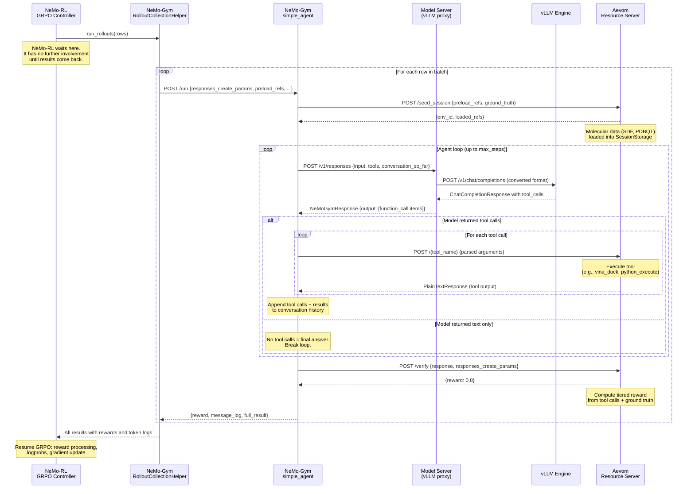

# Aevom-NeMo-RL Interface: Design & Integration Guide

This document captures the architecture of NeMo-RL and NeMo-Gym as it relates to
building Aevom's training pipeline. It is written from hard-won experimentation
integrating Aevom's tool-calling environment with the NeMo-RL v0.5.0 training
framework on a SLURM cluster.

**Audience**: Anyone who needs to design, debug, or extend Aevom's GRPO training
pipeline without having to reverse-engineer NeMo-RL from source.

---

## Table of Contents

1. [High-Level Architecture](#1-high-level-architecture)
2. [The GRPO Training Loop](#2-the-grpo-training-loop)
3. [NeMo-Gym: Environment Framework](#3-nemo-gym-environment-framework)
4. [The Agent-Tool Call Flow](#4-the-agent-tool-call-flow)
5. [Data Format (JSONL)](#5-data-format-jsonl)
6. [Configuration Schema (MasterConfig)](#6-configuration-schema-masterconfig)
7. [Virtual Environment & Process Management](#7-virtual-environment--process-management)
8. [vLLM Integration & Tool Parsing](#8-vllm-integration--tool-parsing)
9. [Policy Model Lifecycle](#9-policy-model-lifecycle)
10. [Cluster & SLURM Orchestration](#10-cluster--slurm-orchestration)
11. [Gotchas & Lessons Learned](#11-gotchas--lessons-learned)
12. [Design Implications for Aevom](#12-design-implications-for-aevom)

---

## 1. High-Level Architecture

NeMo-RL orchestrates reinforcement learning training across multiple distributed
components. For tool-calling GRPO, the architecture looks like this:

```
┌────────────────────────────────────────────────────────────────────┐
│                        NeMo-RL GRPO Controller                     │
│  (Ray driver on head node — runs the training loop)                │
├────────────────────────────────────────────────────────────────────┤
│                                                                    │
│  ┌───────────────┐  ┌──────────────┐  ┌─────────────────────────┐  │
│  │   Megatron    │  │    vLLM      │  │       NeMo-Gym          │  │
│  │   Workers     │  │   Workers    │  │  (Ray remote actor)     │  │
│  │               │  │              │  │                         │  │
│  │  Policy       │  │  Generation  │  │  ┌────────────────────┐ │  │
│  │  Training     │  │  (inference) │  │  │  Resource Server   │ │  │
│  │  (gradient    │  │              │  │  │  (your tools)      │ │  │
│  │   updates)    │  │  Exposes     │  │  ├────────────────────┤ │  │
│  │               │  │  /v1/chat/   │  │  │  Agent Server      │ │  │
│  │  Reads HF     │  │  completions │  │  │  (simple_agent)    │ │  │
│  │  checkpoint,  │  │              │  │  ├────────────────────┤ │  │
│  │  converts to  │  │  Tool parser │  │  │  Model Server      │ │  │
│  │  Megatron     │  │  plugin      │  │  │  (vLLM proxy)      │ │  │
│  │  format       │  │              │  │  └────────────────────┘ │  │
│  └──────┬────────┘  └──────┬───────┘  └─────────────────────────┘  │
│         │                  │                                       │
│         │   Weight Sync    │                                       │
│         │◄────────────────►│                                       │
│         │  (ZMQ IPC or     │                                       │
│         │   NCCL)          │                                       │
└─────────┴──────────────────┴───────────────────────────────────────┘
```

**Key insight**: NeMo-Gym is a _separate process tree_ launched inside a Ray
remote actor. It starts its own FastAPI servers (resource server, agent, model
proxy) and manages its own HTTP-based communication. NeMo-RL treats it as a
black box that accepts task rows and returns rewards.

### Source Files

| Component          | File                                                                                  |
| ------------------ | ------------------------------------------------------------------------------------- |
| GRPO algorithm     | `nemo_rl/algorithms/grpo.py`                                                          |
| NeMo-Gym Ray actor | `nemo_rl/environments/nemo_gym.py`                                                    |
| Main entrypoint    | `examples/nemo_gym/run_grpo_nemo_gym.py`                                              |
| Rollout dispatch   | `nemo_rl/experience/rollouts.py`                                                      |
| Data loading       | `nemo_rl/data/utils.py`, `nemo_rl/data/datasets/response_datasets/nemogym_dataset.py` |

---

## 2. The GRPO Training Loop

One iteration of GRPO proceeds through these phases:

```
                    ┌─────────────────┐
                    │  Load Batch     │ num_prompts_per_step rows from JSONL
                    └────────┬────────┘
                             │
                    ┌────────▼────────┐
                    │  Repeat Prompts │ × num_generations_per_prompt
                    └────────┬────────┘
                             │
                 ┌───────────▼───────────┐
                 │ Sync Weights if Stale │ Megatron → vLLM (ZMQ/NCCL)
                 └───────────┬───────────┘
                             │
               ┌─────────────▼──────────────┐
               │  NeMo-Gym Rollout          │
               │  For each prompt:          │
               │    1. seed_session         │
               │    2. Agent loop           │
               │       (generate → tool     │
               │        call → tool result  │
               │        → generate → ...)   │
               │    3. verify → reward      │
               └─────────────┬──────────────┘
                             │
                 ┌───────────▼───────────┐
                 │  Reward Processing    │ Scaling, baseline, advantages
                 └───────────┬───────────┘
                             │
                 ┌───────────▼───────────┐
                 │  Compute Logprobs     │ Current policy + reference policy
                 └───────────┬───────────┘
                             │
                 ┌───────────▼───────────┐
                 │  Policy Training      │ Clipped PG loss, gradient update
                 └───────────┬───────────┘
                             │
                 ┌───────────▼────────────┐
                 │  Mark Generation Stale │ Next iter will sync weights
                 └────────────────────────┘
```

### Key Parameters

| Parameter                    | Location              | Purpose                                                 |
| ---------------------------- | --------------------- | ------------------------------------------------------- |
| `num_prompts_per_step`       | `grpo.*`              | Batch size (number of unique prompts per step)          |
| `num_generations_per_prompt` | `grpo.*`              | How many rollouts per prompt (for advantage estimation) |
| `max_steps` (agent)          | NeMo-Gym config       | Max tool-calling turns per episode                      |
| `temperature`                | `policy.generation.*` | Sampling temperature (overrides JSONL value)            |

### Inside a Rollout: Who Owns the LLM?

A crucial architectural detail: **NeMo-RL does not drive LLM generation during
rollouts.** It hands off entire JSONL rows to NeMo-Gym and waits for results.
The LLM conversation loop is owned by NeMo-Gym's `simple_agent`.

Here is the sequence for a single episode (e.g., the prompt is
"Diagnose why molecule B binds poorly compared to molecule A"):



**Key ownership boundaries:**

| Component                            | Responsibility                                                                                                                                                              |
| ------------------------------------ | --------------------------------------------------------------------------------------------------------------------------------------------------------------------------- |
| **NeMo-RL**                          | Batching, weight sync, reward processing, logprobs, gradient updates. Treats the rollout as a black box.                                                                    |
| **NeMo-Gym RolloutCollectionHelper** | Routes each row to the correct agent via `agent_ref.name`. Collects results.                                                                                                |
| **`simple_agent`**                   | **Owns the LLM conversation loop.** Decides when to call the LLM, parses tool calls, dispatches to resource server, accumulates conversation history, decides when to stop. |
| **Model Server**                     | Stateless proxy. Converts Responses API format to Chat Completions and back.                                                                                                |
| **vLLM**                             | Generates tokens. Runs the tool parser plugin to extract structured tool calls from model output.                                                                           |
| **Aevom Resource Server**            | **Purely reactive.** Receives tool calls, executes them, returns results. Computes rewards. Has no awareness of the LLM or the conversation loop.                           |

This separation means Aevom's resource server is intentionally simple: it is an
environment, not an agent. It provides tools and judges outcomes. The
orchestration of "when to call the LLM" and "how to manage the conversation" is
handled entirely by NeMo-Gym's agent layer.

### Source Reference

The training loop is in `nemo_rl/algorithms/grpo.py`, function `grpo_train()`,
starting around line 1260. The key phases are:

- **Batch preparation**: lines 1284-1298
- **Weight sync check**: lines 1300-1315
- **Rollout**: lines 1357-1417 (`run_async_nemo_gym_rollout`)
- **Reward processing**: lines 1430-1495
- **Logprob computation**: lines 1579-1609
- **Training update**: lines 1638-1650

---

## 3. NeMo-Gym: Environment Framework

NeMo-Gym is a framework for building tool-calling RL environments. It provides
three types of servers, each running as a separate FastAPI process:

### 3.1 Server Types

**Resource Server** (you implement this):

- Provides tools and computes rewards
- Endpoints: `POST /seed_session`, `POST /verify`, `POST /{tool_name}`
- Manages per-episode state (preloaded data, tool call history)
- Base class: `SimpleResourcesServer` from `nemo_gym.base_resources_server`

**Agent Server** (usually `simple_agent`):

- Runs the conversation loop: generate → extract tool calls → execute → repeat
- NeMo-Gym provides `simple_agent` out of the box
- Endpoints: `POST /run` (entry), `POST /v1/responses` (model interaction)
- Propagates session cookies between model and resource servers

**Model Server** (provided by NeMo-Gym):

- A thin proxy that converts NeMo-Gym's Responses API format to vLLM's
  Chat Completions API
- Endpoints: `POST /v1/responses` → internally calls vLLM's `POST /v1/chat/completions`
- The `vllm_model_for_training.yaml` config wires this up

### 3.2 Server Configuration

Servers are configured via YAML files referenced in `env.nemo_gym.config_paths`.
Each config file defines servers under a top-level key that becomes the server's
routing name:

```yaml
# aevom.yaml — defines resource server AND agent
aevom:
  resources_servers:
    aevom:
      entrypoint: app.py # Relative to resources_servers/aevom/
      dataset_path: /data/molecules
      # ... custom config fields ...

aevom_simple_agent: # <-- This top-level key is the agent's routing name
  responses_api_agents:
    simple_agent:
      entrypoint: app.py # NeMo-Gym's built-in simple_agent
      max_steps: 15
      resources_server:
        type: resources_servers
        name: aevom
      model_server:
        type: responses_api_models
        name: policy_model
      datasets:
        - name: train
          type: train
          jsonl_fpath: /data/train.jsonl
```

**Critical**: The top-level key (e.g., `aevom_simple_agent`) is the name used
for agent routing. Each JSONL row's `agent_ref.name` field must match this key.
If they don't match, you get `omegaconf.errors.ConfigKeyError: Missing key`.

### 3.3 Session Management

NeMo-Gym uses cookie-based sessions to track state across the lifecycle of an
episode:

```
seed_session ──cookie──► tool_call_1 ──cookie──► tool_call_2 ──cookie──► verify
     │                        │                       │                    │
     └──── same SESSION_ID_KEY cookie throughout ──────────────────────────┘
```

- `SESSION_ID_KEY = "session_id"` (from `nemo_gym.server_utils`)
- Middleware auto-assigns a UUID if no session cookie exists
- Your resource server reads it via `request.session[SESSION_ID_KEY]`
- The agent propagates cookies to both model and resource servers

### Source Reference

- Base server: `nemo_gym/base_resources_server.py`
- Session utilities: `nemo_gym/server_utils.py`
- Simple agent: `responses_api_agents/simple_agent/app.py`
- Server startup/venv creation: `nemo_gym/cli.py`

---

## 4. The Agent-Tool Call Flow

This is the complete HTTP flow for one episode, from the perspective of the
`simple_agent`:

```
NeMo-RL Rollout
    │
    ▼
POST /run (agent)
    Body: { responses_create_params, agent_ref, ground_truth, preload_refs, ... }
    │
    ├──► POST /seed_session (resource server)
    │       Body: { task_data, preload_refs, ground_truth }
    │       Response: { env_id, loaded_refs }
    │       Cookie: session_id=<UUID> (set by middleware)
    │
    ├──► LOOP (up to max_steps):
    │    │
    │    ├──► POST /v1/responses (model server → vLLM /v1/chat/completions)
    │    │       Body: { input: [...messages...], tools: [...schemas...] }
    │    │       Response: { output: [function_call items OR text items] }
    │    │
    │    ├──► If function_call items in output:
    │    │    │
    │    │    └──► For each function_call:
    │    │         POST /{tool_name} (resource server)
    │    │             Body: { ...parsed JSON arguments... }
    │    │             Cookie: session_id=<UUID>
    │    │             Response: plain text tool output
    │    │
    │    │    Append function_call_output to conversation
    │    │    Continue loop
    │    │
    │    └──► If no function_calls (text-only response):
    │         Break loop
    │
    └──► POST /verify (resource server)
            Body: { response: <full NeMoGymResponse>, responses_create_params }
            Cookie: session_id=<UUID>
            Response: { reward: <float> }
```

### Key Details

1. **Tool arguments are parsed JSON**: The agent calls
   `json.loads(function_call.arguments)` and POSTs the resulting dict to
   `/{tool_name}`. Your resource server receives this as the JSON body.

2. **Tool output format**: The resource server MUST return a response that
   `simple_agent` can read as raw bytes. Using `PlainTextResponse` works.
   The agent wraps the output in a `function_call_output` message.

3. **Conversation accumulation**: Each iteration of the loop sends the full
   conversation history (original input + all previous outputs) to the model.
   The model sees the full trajectory.

4. **Cookie propagation**: The same session cookie flows through
   `seed_session → tool calls → verify`. This is how your resource server
   maps requests to episode state.

---

## 5. Data Format (JSONL)

Each line of the training JSONL file is a complete task specification:

```json
{
  "agent_ref": {
    "name": "aevom_simple_agent"
  },
  "responses_create_params": {
    "input": [
      { "role": "developer", "content": "<system prompt>" },
      { "role": "user", "content": "<task description with @ref:sdf_xxx references>" }
    ],
    "tools": [
      {
        "name": "vina_dock",
        "type": "function",
        "strict": true,
        "description": "...",
        "parameters": {
          "type": "object",
          "properties": { ... },
          "required": [ ... ],
          "additionalProperties": false
        }
      }
    ],
    "max_output_tokens": 4096,
    "temperature": 0.7
  },
  "ground_truth": { ... },
  "preload_refs": {
    "sdf_winner_complex_0001": "complex_0001/winner.sdf",
    "receptor_complex_0001": "complex_0001/receptor.pdbqt"
  }
}
```

### Critical Fields

| Field                           | Purpose                                                                                      |
| ------------------------------- | -------------------------------------------------------------------------------------------- |
| `agent_ref.name`                | Routes this row to the correct agent server. Must match a top-level config key.              |
| `responses_create_params.input` | Initial conversation messages sent to the model.                                             |
| `responses_create_params.tools` | Tool schemas that enable vLLM function calling. Without this, the model only generates text. |
| `preload_refs`                  | Map of reference_id → file_path. Loaded into session storage during `seed_session`.          |
| `ground_truth`                  | Passed to `verify` for reward computation.                                                   |

### Tool Schema Requirements (FunctionToolParam)

Tool schemas must satisfy the `FunctionToolParam` validation in the agent's
`/run` endpoint. Specifically:

- **`strict: true`** is required at the top level
- **`additionalProperties: false`** is required in the `parameters` object
- Without these, you get `422 Unprocessable Entity` errors

### How Data Flows Through the System

1. `NemoGymDataset` loads raw JSONL lines as strings (not parsed)
2. `nemo_gym_data_processor` parses each line into a dict, stores it in
   `extra_env_info`
3. The GRPO loop reads batches and calls `run_async_nemo_gym_rollout`
4. Each **full row dict** (not an index) is sent to NeMo-Gym's
   `RolloutCollectionHelper.run_examples()`
5. NeMo-Gym reads `row["agent_ref"]["name"]` to route to the correct agent
6. The agent receives the full row and calls `seed_session` then runs the loop

### Data Config (v0.5.0)

In the NeMo-RL v0.5.0 container, the data config uses shorthand keys that
`run_grpo_nemo_gym.py` processes:

```yaml
data:
  train_jsonl_fpath: /data/train.jsonl
  validation_jsonl_fpath: /data/validation.jsonl
  agent_name: aevom_simple_agent
  shuffle: true
  num_workers: 0
```

Internally, `setup_response_data()` translates `train_jsonl_fpath` into a
`ResponseDatasetConfig` with `data_path`, and uses `NemoGymDataset` as the
dataset class. The `agent_name` is injected into each row if `agent_ref` is
not already present.

**Note**: The latest NeMo-RL source uses a nested `data.train.data_path`
structure instead. If you upgrade the container, the config format changes.

---

## 6. Configuration Schema (MasterConfig)

NeMo-RL uses a strict `MasterConfig` TypedDict. The GRPO YAML must match
this schema exactly or Hydra/OmegaConf will reject it.

### Top-Level Keys

```python
class MasterConfig(TypedDict):
    policy: PolicyConfig          # Model, training, generation
    loss_fn: ClippedPGLossConfig  # PPO/GRPO clipping parameters
    env: dict[str, Any]           # Environment config (nemo_gym)
    data: DataConfig              # Dataset paths and settings
    grpo: GRPOConfig              # Algorithm hyperparameters
    logger: GRPOLoggerConfig      # Logging (WandB, TensorBoard)
    cluster: ClusterConfig        # num_nodes, gpus_per_node
    checkpointing: CheckpointingConfig
```

### Policy Config Structure

```yaml
policy:
  model_name: "nvidia/NVIDIA-Nemotron-Nano-9B-v2" # HF model ID or local path
  tokenizer:
    name: ${policy.model_name}
  train_global_batch_size: ...
  train_micro_batch_size: 1
  max_total_sequence_length: 8192
  precision: "bfloat16"

  dtensor_cfg: # DTensor/FSDP policy training (alternative to Megatron)
    enabled: false
    tensor_parallel_size: 2 # <-- Note: different field name than Megatron

  megatron_cfg: # Megatron policy training
    enabled: true
    tensor_model_parallel_size: 2 # <-- Note: "tensor_MODEL_parallel_size"
    pipeline_model_parallel_size: 1
    expert_model_parallel_size: 1 # Must be present even for non-MoE models
    # ... many more fields (see below)

  generation: # vLLM generation config
    backend: "vllm"
    vllm_cfg:
      tensor_parallel_size: 1 # vLLM TP (can differ from Megatron TP)
      gpu_memory_utilization: 0.85
      expose_http_server: true # Required for NeMo-Gym
      tool_parser_plugin: /path/to/parser.py
      http_server_serving_chat_kwargs:
        enable_auto_tools: true
        tool_parser: nemotron_json
    colocated:
      enabled: true # Same GPU for training + generation
```

### The Megatron Config Minefield

The Megatron config (`policy.megatron_cfg`) has many fields that are
**unconditionally accessed** by the Megatron worker, even if they are
irrelevant to your model. Missing any of them causes a `KeyError`.

Fields that MUST be present (even for non-MoE models like Nemotron-9B):

```yaml
megatron_cfg:
  # Standard parallelism
  tensor_model_parallel_size: 2
  pipeline_model_parallel_size: 1
  context_parallel_size: 1

  # MoE fields — required even if model has no MoE layers
  expert_tensor_parallel_size: 1
  expert_model_parallel_size: 1
  freeze_moe_router: false
  moe_router_dtype: "fp64" # Accessed in setup.py but NOT in TypedDict!
  moe_router_load_balancing_type: "none"
  moe_router_bias_update_rate: 0.0
  moe_enable_deepep: false
  moe_token_dispatcher_type: "allgather"
  moe_shared_expert_overlap: false
  defer_fp32_logits: false
  moe_permute_fusion: false # Not in TypedDict either

  # Training
  activation_checkpointing: true
  empty_unused_memory_level: 0
  bias_activation_fusion: false
  apply_rope_fusion: true
  sequence_parallel: false
  pipeline_dtype: "bfloat16"
  train_iters: 100000

  # Sub-configs
  optimizer: { ... }
  scheduler: { ... }
  distributed_data_parallel_config: { ... }
```

**Warning**: Several fields like `moe_router_dtype` and `moe_permute_fusion`
are accessed via dictionary lookup in `nemo_rl/models/megatron/setup.py` but
are NOT defined in the `MegatronConfig` TypedDict. This means the type checker
won't catch them, but the runtime will crash if they're missing.

### Environment Config

```yaml
env:
  should_use_nemo_gym: true
  should_log_nemo_gym_responses: true
  nemo_gym: # Passed as initial_global_config_dict
    is_trajectory_collection: false
    config_paths: # NeMo-Gym YAML configs to load
      - responses_api_models/vllm_model/configs/vllm_model_for_training.yaml
      - /config/aevom_nemo_gym.yaml
    # Overrides for agent config (key must match agent's top-level config key)
    aevom_simple_agent:
      responses_api_agents:
        simple_agent:
          max_steps: 15
    # Policy model overrides
    policy_model:
      responses_api_models:
        vllm_model:
          uses_reasoning_parser: false
```

The `env.nemo_gym` dict is passed directly to NeMo-Gym as
`initial_global_config_dict`. NeMo-Gym merges it with configs from
`config_paths` to build its global config, then starts the server processes.

---

## 7. Virtual Environment & Process Management

NeMo-RL creates **separate Python virtual environments** for each worker type.
This is one of the most surprising aspects of its architecture.

### Worker-to-Venv Mapping

| Worker                 | Venv            | Python Executable         |
| ---------------------- | --------------- | ------------------------- |
| `VllmGenerationWorker` | `vllm` venv     | `uv run --extra vllm`     |
| `MegatronPolicyWorker` | `mcore` venv    | `uv run --extra mcore`    |
| `NemoGym`              | `nemo_gym` venv | `uv run --extra nemo_gym` |

Source: `nemo_rl/distributed/ray_actor_environment_registry.py`

### Venv Creation Process

1. `create_local_venv()` in `nemo_rl/utils/venvs.py` uses `uv` to create venvs
2. Venvs are placed in `$NEMO_RL_VENV_DIR` (default: `venvs/` in the NeMo-RL root)
3. On multi-node SLURM, venvs must be on a **shared filesystem** (Lustre)
4. `create_local_venv_on_each_node()` uses Ray `STRICT_SPREAD` to build once per node

### The `NEMO_RL_PY_EXECUTABLES_SYSTEM=1` Escape Hatch

Setting this environment variable tells NeMo-RL to use the **system Python**
for all workers instead of creating per-worker venvs. This is essential when:

- You bake all dependencies into the container at build time
- The per-worker venvs on Lustre would be too slow or fragile
- You need custom packages (like chemistry tools) available to Gym workers

In the Aevom training container, we set this in the Dockerfile:

```dockerfile
ENV NEMO_RL_PY_EXECUTABLES_SYSTEM=1
```

### NeMo-Gym Process Tree

When NeMo-Gym starts (inside its Ray actor), it launches its own process tree:

```
NemoGym Ray Actor
  └── RunHelper.start()
        ├── HeadServer (global config distribution)
        ├── Resource Server process (your app.py)
        │     └── Venv created from resources_servers/aevom/requirements.txt
        ├── Agent Server process (simple_agent/app.py)
        │     └── Venv created from responses_api_agents/simple_agent/requirements.txt
        └── Model Server process (vllm_model/app.py)
              └── Proxies to vLLM HTTP server
```

**Critical for Aevom**: If your resource server has a `requirements.txt`,
NeMo-Gym creates an **isolated venv** for it. Packages installed in the main
container are NOT available unless:

1. You set `NEMO_RL_PY_EXECUTABLES_SYSTEM=1`, OR
2. You include all dependencies in the `requirements.txt`, OR
3. You use `--system-site-packages` in the venv creation

This is why our chemistry packages (rdkit, meeko, vina) were missing when we
first tried live tool execution — they were installed in the container's main
Python but the resource server ran in an isolated venv that didn't have them.

---

## 8. vLLM Integration & Tool Parsing

### How vLLM Serves Tool Calls

When `expose_http_server: true` in `vllm_cfg`, vLLM starts an HTTP server that
exposes OpenAI-compatible endpoints. NeMo-Gym's model server proxies to it:

```
Agent
  │  POST /v1/responses (NeMo-Gym format)
  ▼
Model Server (vllm_model)
  │  Converts to Chat Completions format
  │  POST /v1/chat/completions
  ▼
vLLM HTTP Server
  │  Generates tokens, runs tool parser
  │  Returns ChatCompletionResponse with tool_calls
  ▼
Model Server
  │  Converts back to NeMo-Gym format
  ▼
Agent
  │  Extracts function_call items
  │  Calls resource server
```

### Tool Parser Plugin System

vLLM uses a plugin system to parse tool calls from model output:

```python
# In vLLM worker initialization (vllm_worker_async.py):
from vllm.entrypoints.openai.tool_parsers import ToolParserManager

tool_parser_plugin = self.cfg["vllm_cfg"].get("tool_parser_plugin")
if tool_parser_plugin:
    ToolParserManager.import_tool_parser(tool_parser_plugin)
```

The plugin file registers a parser class:

```python
@ToolParserManager.register_module("nemotron_json")
class NemotronToolCallParser(ToolParser):
    # Parses <TOOLCALL>[{"name": "...", "arguments": {...}}]</TOOLCALL>
```

### Configuration

```yaml
policy:
  generation:
    vllm_cfg:
      tool_parser_plugin: /aevom/training/tool_parsers/nemotron_toolcall_parser.py
      http_server_serving_chat_kwargs:
        enable_auto_tools: true
        tool_parser: nemotron_json # Name registered by the plugin
```

Both fields are needed:

- `tool_parser_plugin`: Path to the Python file (imported at startup)
- `tool_parser`: Name of the registered parser class (used at runtime)

### Tool Schema in Chat Completions

The `tools` array from `responses_create_params.tools` in the JSONL gets
converted to OpenAI's Chat Completions `tools` format and sent to vLLM.
Without tools in the JSONL, vLLM won't parse tool calls even if the model
outputs them — the model will just generate text.

---

## 9. Policy Model Lifecycle

### Model Import

1. `model_name` in `PolicyConfig` can be a HuggingFace model ID
   (e.g., `nvidia/NVIDIA-Nemotron-Nano-9B-v2`) or a local path
2. On first run, `import_model_from_hf_name()` downloads the HF checkpoint
   and converts it to Megatron format using `AutoBridge`
3. Converted checkpoint is saved to `pretrained_path` for reuse
4. vLLM loads the original HF checkpoint directly (no conversion needed)

### Weight Synchronization

After each training step, the model weights in Megatron are newer than vLLM's
copy. The `POLICY_GENERATION_STALE` flag triggers a sync before the next
generation phase.

**Colocated mode** (same GPUs):

```
Megatron → offload optimizer → stream weights via ZMQ IPC → vLLM loads weights → reload optimizer
```

**Non-colocated mode** (different GPUs/nodes):

```
Megatron → broadcast weights via NCCL collective → vLLM receives weights
```

The colocated mode is preferred for smaller models (fewer GPUs needed) but
requires careful memory management since training and inference share GPU memory.

### Tensor Parallelism Naming Confusion

Be careful with tensor parallelism configuration — the field names differ:

| Component | Field Name                                | What It Controls |
| --------- | ----------------------------------------- | ---------------- |
| Megatron  | `megatron_cfg.tensor_model_parallel_size` | Training TP      |
| vLLM      | `vllm_cfg.tensor_parallel_size`           | Inference TP     |
| DTensor   | `dtensor_cfg.tensor_parallel_size`        | FSDP training TP |

These can be set independently. For example, Megatron TP=2 with vLLM TP=1 is
valid (and is what Aevom uses for the 9B model).

### Model Compatibility

Not all models work with NeMo-RL v0.5.0's Megatron bridge. During our
experiments:

- **Nemotron-Nano-30B (MoE+Mamba hybrid)**: Failed with
  `ValueError: In hybrid override pattern, 'E' is not one of {'-', 'M', '*'}`.
  The Megatron bridge doesn't support the `'E'` (Expert) layer type.
- **Nemotron-Nano-9B-v2**: Works correctly. Standard transformer architecture.

---

## 10. Cluster & SLURM Orchestration

### SLURM + Pyxis/Enroot

On the cluster, jobs run inside Enroot containers (`.sqsh` squashfs images) managed by
the Pyxis SLURM plugin:

```bash
srun --container-image=/path/to/image.sqsh \
     --container-mounts=/data:/data,/results:/results \
     python run_grpo_nemo_gym.py --config /config/grpo.yaml
```

The container sees a single filesystem namespace. All NeMo-RL processes
(Megatron, vLLM, NeMo-Gym) run inside this container.

### Ray Across SLURM Nodes

NeMo-RL uses Ray for distributed orchestration:

1. A Ray head node starts on the first SLURM node
2. Worker nodes connect to the head via `ray start --address=<head_ip>:6379`
3. `RayVirtualCluster` creates placement groups for worker allocation
4. Workers are launched as Ray actors within their placement groups

For multi-node training, the SLURM script must:

- Start Ray on each node
- Set `NCCL_*` environment variables for GPU communication
- Ensure shared filesystem access for checkpoints and venvs

### Cluster Config

```yaml
cluster:
  gpus_per_node: 8
  num_nodes: 1 # Can be increased for multi-node training
```

This controls how Ray allocates resources. The GRPO algorithm uses
`gpus_per_node` to determine parallelism degrees.

---

## 11. Gotchas & Lessons Learned

These are hard-won findings from integrating Aevom with NeMo-RL v0.5.0.

### 11.1 Config Schema is Strict

The YAML config MUST match `MasterConfig` exactly. Extra keys or wrong nesting
causes `omegaconf.errors.ConfigAttributeError`. There is no schema documentation
— the TypedDicts in `nemo_rl/algorithms/grpo.py` and
`nemo_rl/models/policy/__init__.py` are the source of truth.

**Fix**: Always base your config on a working example
(`grpo_workplace_assistant_nemotron_nano_v2_9b.yaml`).

### 11.2 Data Config Changed Between Versions

NeMo-RL v0.5.0 (in the NGC container) uses `data.train_jsonl_fpath` and
`data.validation_jsonl_fpath`. The latest source uses `data.train.data_path`.
Using the wrong format causes `KeyError: 'train_jsonl_fpath'`.

**Fix**: Check which version is in your container before writing the config.

### 11.3 vLLM kwargs Collisions

The framework passes `trust_remote_code=True` to vLLM internally. If you also
set it in `vllm_kwargs`, you get
`TypeError: dict() got multiple values for keyword argument 'trust_remote_code'`.

**Fix**: Don't set `trust_remote_code` in `vllm_kwargs`.

### 11.4 vLLM Cache Dtype

Setting `mamba_ssm_cache_dtype: "bfloat16"` in `vllm_kwargs` causes
`pydantic ValidationError` because vLLM's `CacheConfig` only accepts `"auto"`
or `"float32"`.

**Fix**: Use `mamba_ssm_cache_dtype: "float32"` or omit it entirely.

### 11.5 Tensor Parallelism vs Query Groups

For models with grouped-query attention, Megatron's
`tensor_model_parallel_size` must be a divisor of `num_query_groups`. The
Nemotron-30B model has 2 query groups, so TP=8 fails:
`ValueError: num_query_groups (2) must be a multiple of tensor_model_parallel_size (8)`.

**Fix**: Set Megatron TP to a valid divisor (e.g., TP=2 for 2 query groups).

### 11.6 MoE Config Keys Are Always Required

Even for non-MoE models, the Megatron worker unconditionally accesses MoE
config fields like `expert_model_parallel_size` and `moe_router_dtype`. Missing
them causes `KeyError`.

**Fix**: Always include all MoE fields with sensible defaults (see section 6).

### 11.7 Agent Name Routing

Each JSONL row must have `agent_ref.name` matching a top-level key in the
NeMo-Gym config. NeMo-Gym's `RolloutCollectionHelper.run_examples()` reads
`row["agent_ref"]["name"]` to route each example to the correct agent process.

If `agent_ref.name = "simple_agent"` but the config key is
`aevom_simple_agent`, you get `ConfigKeyError: Missing key simple_agent`.

**Fix**: Ensure `agent_ref.name` in the JSONL matches the top-level config key
exactly.

### 11.8 Tool Schema Validation (FunctionToolParam)

The `simple_agent`'s `/run` endpoint validates tool schemas against the
`FunctionToolParam` pydantic model. Missing `strict: true` or
`additionalProperties: false` causes `422 Unprocessable Entity`.

**Fix**: Every tool schema needs `strict: true` at the top level and
`additionalProperties: false` inside `parameters`.

### 11.9 Resource Server Venv Isolation

NeMo-Gym creates an isolated Python venv for each resource server based on its
`requirements.txt` or `pyproject.toml`. Packages in the main container are NOT
available in this venv.

**Fix**: Either set `NEMO_RL_PY_EXECUTABLES_SYSTEM=1` (use system Python for
all workers) or ensure your resource server's `requirements.txt` includes all
needed packages.

### 11.10 Non-Monotonic Trajectory Errors

If a tool returns an error message instead of a valid response, vLLM's chat
template processing can fail with
`AssertionError: Found possibly non-monotonically increasing trajectory!`.
This happens because the error disrupts the expected message ordering in the
conversation.

**Fix**: Ensure tools always return well-formed responses. Wrap tool execution
in try/except and return clean error strings that don't break the conversation
structure.

---

## 12. Design Implications for Aevom

### 12.1 Tool Interface Fidelity

**The tool schemas in the training JSONL define what the LLM learns to call.**
If training schemas differ from production schemas (different parameter names,
different APIs), the LLM learns the wrong interface.

This means:

- `responses_create_params.tools` must use the **exact same parameter names**
  as production tools
- The `python_execute` tool's sandbox must provide the same `aevom.*` client
  API the model will use in production
- The `vina_dock` tool must accept the same parameters
  (`receptor_pdb_ref`, `ligand_sdf_ref`, `center_x`, `center_y`, `center_z`, etc.)

### 12.2 Tool Execution Environment

There are three viable approaches for running Aevom's tools during training:

**Option A: In-process reimplementation** (current approach)

- Pros: No external services needed
- Cons: Diverges from production interfaces; teaches wrong API

**Option B: Run actual service code as background processes**

- Copy pyexec/vina FastAPI code into the training container
- Start them as background uvicorn processes before training
- Resource server forwards tool calls via HTTP
- Pros: Same code, same HTTP interfaces, same behavior
- Cons: More moving parts in the container

**Option C: Run actual Docker containers as sidecars**

- Pros: Identical to production
- Cons: Complex container orchestration on SLURM

Option B is recommended — it gives production-faithful interfaces without the
complexity of nested container orchestration.

### 12.3 The aevom Client Problem

The production `python_execute` tool provides an `aevom` client object inside
the pyexec sandbox. This client calls back to the Aevom backend API for data
access (`GET /api/sandbox/data/{ref}`).

In training, there is no Aevom backend. The resource server's `SessionStorage`
holds the molecular data. To make the `aevom` client work:

1. Add sandbox API endpoints to the resource server:
   - `GET /api/sandbox/data/{reference}` → reads from `SessionStorage`
   - `POST /api/sandbox/store` → writes to `SessionStorage`
   - `POST /api/sandbox/visualize` → no-op (no frontend)
2. Point the pyexec service's `backend_url` at the resource server
3. The `aevom` client transparently calls the resource server as if it were
   the real backend

### 12.4 Session Storage as the Data Bridge

The `SessionStorage` in the resource server is the central data bridge:

```
seed_session: preload_refs files → SessionStorage
python_execute: aevom.load(ref) → SessionStorage (via resource server callback)
vina_dock: resource server reads receptor/ligand from SessionStorage → sends to vina service
verify: reads tool_calls from session → computes reward
```

All tool execution must go through `SessionStorage` for data access. This
replaces the production Redis-backed `DataStorageService`.

### 12.5 System Prompt Must Match Production

The system prompt in the training JSONL teaches the LLM which tools are
available and how to use them. If it references a non-existent API
(e.g., `storage.retrieve_text(ref_id)`), the model will learn to generate
code with that API.

The system prompt must document the **production** `aevom.*` API:

- `aevom.load(ref)`, `aevom.load_rdkit_mol(ref)`
- `aevom.store_sdf(content)`, `aevom.store_smiles(smiles)`
- `aevom.search_pubchem(name)`, etc.

---

## Appendix: Reference File Locations

### NeMo-RL (in container at /opt/nemo-rl)

| File                                                                  | Purpose                                     |
| --------------------------------------------------------------------- | ------------------------------------------- |
| `nemo_rl/algorithms/grpo.py`                                          | GRPO algorithm, MasterConfig, training loop |
| `nemo_rl/models/policy/__init__.py`                                   | PolicyConfig, MegatronConfig TypedDicts     |
| `nemo_rl/models/policy/workers/megatron_policy_worker.py`             | Megatron training worker                    |
| `nemo_rl/models/generation/vllm/vllm_worker_async.py`                 | vLLM async worker, tool parser registration |
| `nemo_rl/models/generation/vllm/vllm_backend.py`                      | Weight sync (ZMQ IPC, NCCL)                 |
| `nemo_rl/environments/nemo_gym.py`                                    | NeMo-Gym Ray actor, rollout dispatch        |
| `nemo_rl/experience/rollouts.py`                                      | `run_async_nemo_gym_rollout`                |
| `nemo_rl/data/utils.py`                                               | `setup_response_data`, dataset loading      |
| `nemo_rl/data/datasets/response_datasets/nemogym_dataset.py`          | JSONL dataset class                         |
| `nemo_rl/data/processors.py`                                          | `nemo_gym_data_processor`                   |
| `nemo_rl/distributed/virtual_cluster.py`                              | Ray cluster, placement groups               |
| `nemo_rl/distributed/ray_actor_environment_registry.py`               | Worker-to-venv mapping                      |
| `nemo_rl/utils/venvs.py`                                              | Venv creation logic                         |
| `examples/nemo_gym/run_grpo_nemo_gym.py`                              | Main entrypoint                             |
| `examples/nemo_gym/grpo_workplace_assistant_nemotron_nano_v2_9b.yaml` | Reference config                            |

### NeMo-Gym (in container at /opt/nemo-rl/3rdparty/Gym-workspace/Gym)

| File                                       | Purpose                                           |
| ------------------------------------------ | ------------------------------------------------- |
| `nemo_gym/base_resources_server.py`        | SimpleResourcesServer base class                  |
| `nemo_gym/server_utils.py`                 | SESSION_ID_KEY, server client, config utilities   |
| `nemo_gym/cli.py`                          | Server startup, venv creation, process management |
| `nemo_gym/rollout_collection.py`           | RolloutCollectionHelper, agent routing            |
| `nemo_gym/config_types.py`                 | AGENT_REF_KEY and other constants                 |
| `responses_api_agents/simple_agent/app.py` | Simple agent implementation                       |
| `responses_api_models/vllm_model/app.py`   | vLLM model server proxy                           |

### Aevom Training Files

| File                                                | Purpose                                           |
| --------------------------------------------------- | ------------------------------------------------- |
| `training/nemo_gym_wrapper/app.py`                  | Resource server (NeMo-Gym wrapper)                |
| `training/nemo_gym_wrapper/inprocess_tools.py`      | In-process tool reimplementation (to be replaced) |
| `training/tool_parsers/nemotron_toolcall_parser.py` | Nemotron tool call parser for vLLM                |
| `training/configs/grpo/aevom_grpo_30b_nanov3.yaml`  | NeMo-RL GRPO config (Megatron, 4-node, 32K)       |
| `training/configs/aevom_nemo_gym.yaml`              | NeMo-Gym resource/agent server config             |
| `training/slurm/container/Dockerfile`               | Training container definition                     |
| `training/slurm/grpo/test_live_eos.sbatch`          | SLURM job submission script                       |
| `backend/api/training/dataset_adapter.py`           | JSONL training data generation (standalone CLI)   |
| `training/scripts/generate_dataset.sh`              | Convenience wrapper for dataset generation        |

### Aevom Production Tool Services

| File                                  | Purpose                                             |
| ------------------------------------- | --------------------------------------------------- |
| `services/pyexec/app/main.py`         | PyExec FastAPI service (sandboxed Python execution) |
| `services/pyexec/app/aevom_client.py` | `aevom` client object for sandbox                   |
| `services/pyexec/app/sandbox.py`      | RestrictedPython sandbox                            |
| `services/vina/app/main.py`           | Vina docking FastAPI service                        |
| `services/vina/app/docking.py`        | Docking engine (CPU/GPU)                            |
| `services/vina/app/preparation.py`    | Receptor/ligand PDBQT preparation                   |
| `backend/api/tools/python_exec.py`    | Production python_execute tool                      |
| `backend/api/tools/vina.py`           | Production vina_dock tool                           |
| `backend/api/tools/rdkit.py`          | Production molecule_info tool                       |
