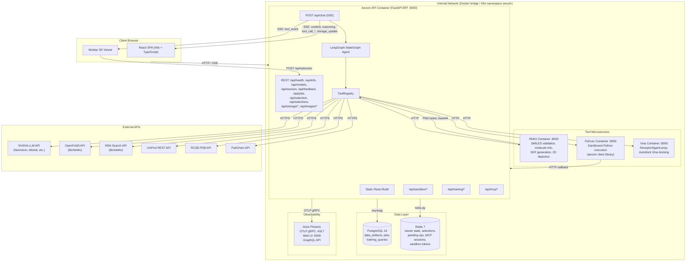

# 1. System Overview

All deployable containers, databases, external APIs, and network boundaries.

## Service Inventory

| Service      | Image / Build                                     | Ports           | Volumes                              | Health Check          |
| ------------ | ------------------------------------------------- | --------------- | ------------------------------------ | --------------------- |
| **backend**  | `backend/Dockerfile` (multi-stage: Node + Python), tagged `aevom-api:latest` | 5180:8000       | `prompts.md` (ro), `backend/api` (dev) | depends_on all others |
| **postgres** | `postgres:16-alpine`                              | 5432 (internal) | `postgres_data`                      | `pg_isready`          |
| **rdkit**    | `services/rdkit/Dockerfile`                       | 8000 (internal) | --                                   | `curl /health`        |
| **pyexec**   | `services/pyexec/Dockerfile`                      | 8000 (internal) | --                                   | `curl /health`        |
| **vina**     | `services/vina/Dockerfile`                        | 8000 (internal) | --                                   | `curl /health`        |
| **admet**    | `services/admet/Dockerfile`                       | 8000 (internal) | --                                   | `curl /ready`         |
| **plip**     | `services/plip/Dockerfile`                        | 8000 (internal) | --                                   | `curl /health`        |
| **redis**    | `redis:7-alpine`                                  | 6379            | --                                   | `redis-cli ping`      |
| **phoenix**  | `arizephoenix/phoenix:version-13.0.3`             | 6080:6006       | `phoenix_data`                       | --                    |

The Compose service is `backend`, the image it builds is `aevom-api:latest`. The
image name matches the registry and the Helm chart; the service name is what the
`aevom-backend-1` container name and the Makefile's health gates derive from.

## Volumes

| Volume          | Purpose                     | Mounted By |
| --------------- | --------------------------- | ---------- |
| `postgres_data` | PostgreSQL data persistence | postgres   |
| `phoenix_data`  | Trace storage               | phoenix    |

No volume is shared between services. 2D molecule depictions used to live on a
`shared_images` volume, which in Kubernetes meant a ReadWriteMany claim; RDKit
now returns PNG bytes inline and the API stores them as `png` artifacts in
Postgres, served by `GET /api/images/{reference}`. That removed the only
correctness trap in the storage layout — RDKit runs behind an HPA, so a file
written by one replica was invisible to the others.

## Network

- Docker Compose: bridge network `192.168.249.0/24`
- Kubernetes: namespace `aevom`, NGINX Ingress at the chart's `ingress.host`

## Source References

- `docker-compose.yml` -- every service, 2 volumes, bridge network
- `deploy/helm/aevom/` -- the Helm chart; `values.yaml` is the deployment contract
- `deploy/helm/README.md` -- install, values table, cutover runbook
- `backend/api/main.py` -- all `/api/*` endpoints, router mounts, lifespan
- `backend/api/tools/registry.py` -- `ToolRegistry` dispatches to microservices and external APIs
- `services/rdkit/`, `services/pyexec/`, `services/vina/`, `services/admet/`, `services/plip/` -- microservice implementations
