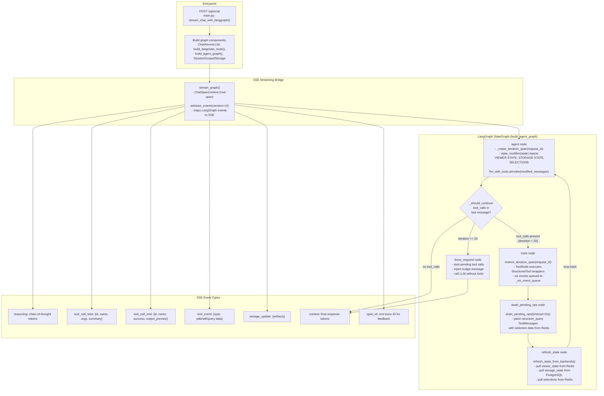
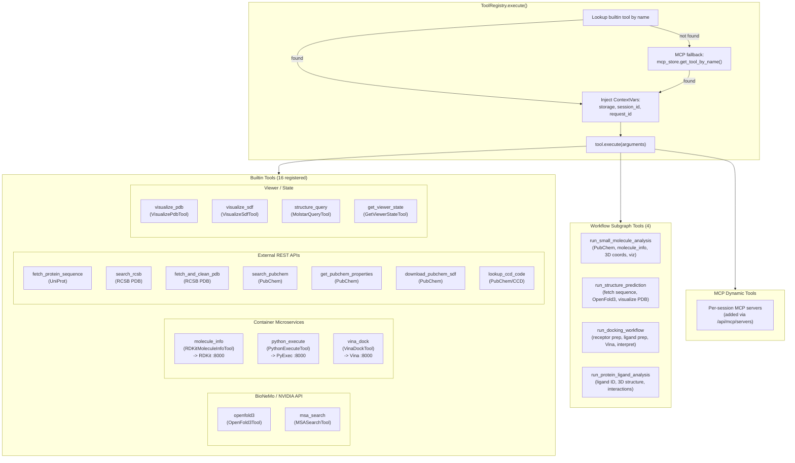
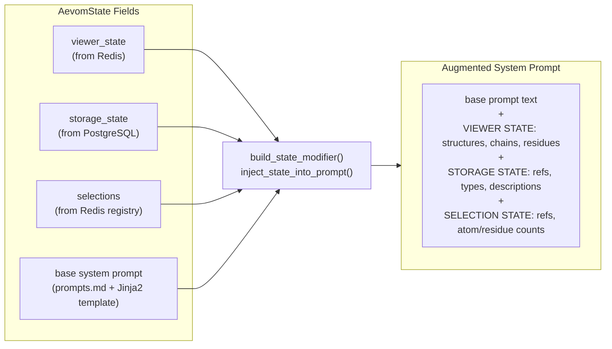

# 2. Agent Execution Flow

The LangGraph StateGraph loop in full detail, from the `/api/chat` entrypoint through tool dispatch and state refresh.

## Agent Graph

## Tool Dispatch

## State Modifier Detail

## Source References

- `backend/api/main.py` -- `/api/chat` endpoint, `stream_chat_with_langgraph()`
- `backend/api/graph/agent.py` -- `build_agent_graph()`, 5 nodes (agent, tools, await_pending_ops, refresh_state, force_respond), `_should_continue` routing, iteration span management
- `backend/api/graph/state_modifier.py` -- `build_state_modifier()`, `inject_state_into_prompt()`, `format_viewer_state/storage_state/selections`
- `backend/api/graph/tools.py` -- `build_langchain_tools()`, StructuredTool wrappers, `_viz_event_queue`, pending ops
- `backend/api/graph/streaming.py` -- `stream_graph()`, LangGraph event-to-SSE mapping
- `backend/api/tools/registry.py` -- `ToolRegistry`, `_register_default_tools()` (16 builtin tools), MCP fallback
- `backend/api/graph/workflows/__init__.py` -- `build_workflow_tools()`, 4 subgraph tools
- `backend/api/graph/llm.py` -- `ChatAevomLLM` LangChain adapter
- `backend/api/llm/client.py` -- `LLMClient`, NVIDIA API calls
- `backend/api/llm/config.py` -- `ModelConfig`, model selection
