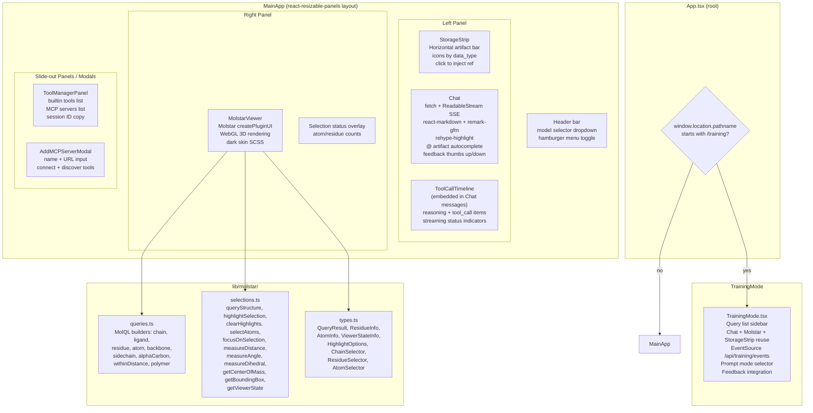
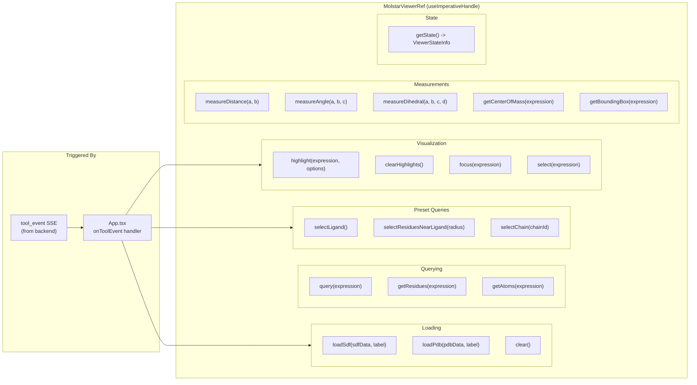

# 3. Frontend Components

React component tree, Molstar integration, and all data flows between browser and backend.

## Component Tree

## Data Flows

```mermaid
sequenceDiagram
    participant User
    participant Chat as Chat.tsx
    participant App as App.tsx
    participant Molstar as MolstarViewer
    participant Strip as StorageStrip
    participant API as Aevom API

    Note over User,API: Chat Request Flow (fetch + ReadableStream)
    User->>Chat: type message + send
    Chat->>App: getState() from MolstarViewer ref
    Chat->>API: POST /api/chat {messages, viewer_state, session_id, model_id}
    API-->>Chat: SSE stream (data: JSON lines)

    loop Stream Processing
        Chat->>Chat: Parse SSE line
        alt reasoning event
            Chat->>Chat: Update timeline (reasoning item)
        else tool_call_start event
            Chat->>Chat: Add timeline item (pending)
        else tool_event (visualize_pdb/sdf)
            Chat->>App: onToolEvent callback
            App->>Molstar: loadPdb() or loadSdf()
        else tool_event (structure_query)
            Chat->>App: onToolEvent callback
            App->>Molstar: executeQuery() -> highlight/focus/select
            Molstar->>API: POST /api/selection {query_id, atoms, residues}
        else tool_call_end event
            Chat->>Chat: Update timeline (complete/error)
        else storage_update event
            Chat->>App: onStorageUpdate callback
            App->>Strip: Update artifacts prop
        else content event
            Chat->>Chat: Append to assistant message
        else span_id event
            Chat->>Chat: Store for feedback
        end
    end

    Note over User,API: Artifact Strip Flow
    App->>API: GET /api/storage/artifacts?session_id=...
    API-->>Strip: {artifacts: [...]}
    User->>Strip: Click artifact icon
    Strip->>Chat: onInjectRef(reference) -> insert @ref into input

    Note over User,API: MCP Tool Management
    User->>ToolManager: Add MCP server
    ToolManager->>API: POST /api/mcp/servers {name, url}
    API-->>ToolManager: {server with discovered tools}
    ToolManager->>API: GET /api/mcp/tools?session_id=...
    API-->>ToolManager: {builtin + MCP tools}

    Note over User,API: Training Mode (EventSource)
    User->>TrainingMode: Navigate to /training
    TrainingMode->>API: new EventSource(/api/training/events)
    API-->>TrainingMode: SSE: query_created, query_deleted, feedback_submitted
```

## Molstar Imperative API (MolstarViewerRef)

## Source References

- `frontend/src/App.tsx` -- root component, route dispatch (`/training*` vs MainApp), react-resizable-panels layout, tool event handler, session/model management
- `frontend/src/components/Chat.tsx` -- `fetch` + `ReadableStream` SSE consumer, `TimelineItem` type, markdown rendering, `@`-ref autocomplete, feedback
- `frontend/src/components/MolstarViewer.tsx` -- `MolstarViewerRef` imperative API (loadSdf, loadPdb, query, highlight, measure, getState), Molstar `createPluginUI`
- `frontend/src/components/ToolCallTimeline.tsx` -- renders `TimelineItem[]` with tool status icons and reasoning previews
- `frontend/src/components/StorageStrip.tsx` -- `Artifact` interface, icon mapping by `data_type`, tooltip, `onInjectRef` callback
- `frontend/src/components/ToolManagerPanel.tsx` -- MCP server listing, builtin tool listing, session management
- `frontend/src/components/AddMCPServerModal.tsx` -- MCP server registration form
- `frontend/src/components/TrainingMode.tsx` -- `EventSource` for `/api/training/events`, query management, prompt mode selection
- `frontend/src/lib/molstar/queries.ts` -- MolQL expression builders
- `frontend/src/lib/molstar/selections.ts` -- Molstar query execution, highlight/focus/measurement operations
- `frontend/src/lib/molstar/types.ts` -- shared TypeScript types for viewer state and query results
