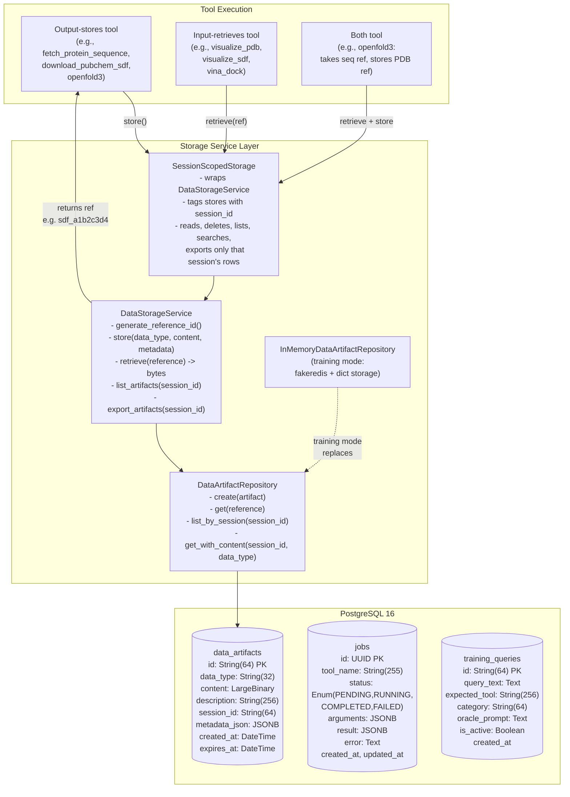
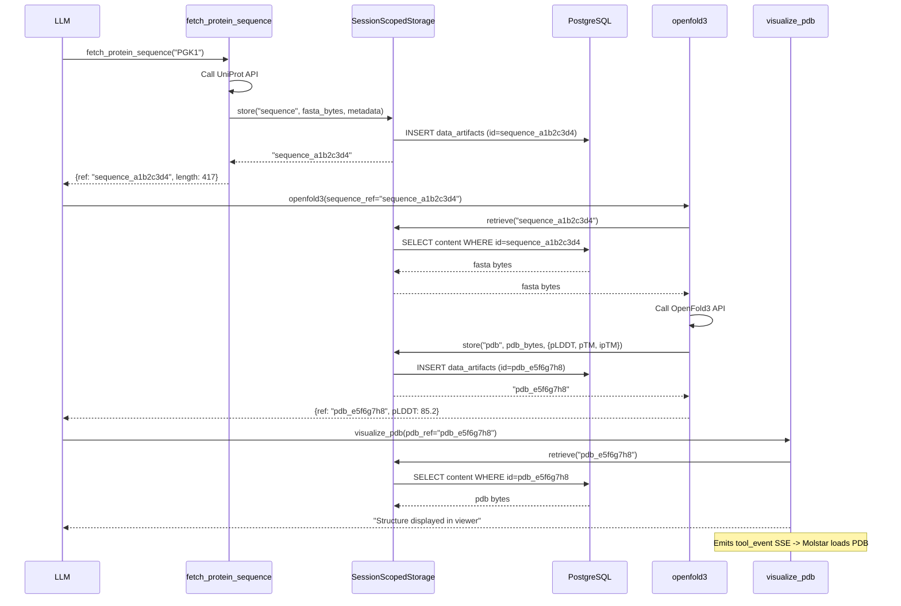

# 4. Storage Subsystem

How data flows between tools, PostgreSQL, Redis, and the frontend via reference-based artifact storage.

## Storage Architecture

## Redis Key Patterns

```mermaid
flowchart TB
    subgraph redis ["Redis 7"]
        subgraph viewer_keys ["Viewer State"]
            ViewerKey["viewer:{request_id}\nJSON: structures, chains,\nresidues, atoms, has_ligand\nTTL: VIEWER_STATE_TTL"]
        end

        subgraph selection_keys ["Selections Registry"]
            SelKey["sel:{session_id}\nJSON array of SelectionInfo\nTTL: 3600s (refreshed on access)\nMax 10 per session"]
        end

        subgraph pending_keys ["Pending Ops (Pub/Sub)"]
            PendingMarker["pending:{query_id}\nMarker key\nTTL: 300s"]
            PendingAck["pending_ack:{query_id}\nPub/Sub channel\nfor cross-pod ack"]
        end

        subgraph mcp_keys ["MCP Session Store"]
            MCPKey["mcp:{session_id}\nJSON: server configs\n(name, url, api_key, tools)\nTTL: 4h (DEFAULT_SESSION_TTL)"]
        end

        subgraph owner_keys ["Session Ownership"]
            OwnerKey["aevom:session_owner:{session_id}\nsha256(owner token)\nTTL: 24h, refreshed on use"]
        end

        subgraph sandbox_keys ["Sandbox Sessions"]
            SandboxKey["sandbox:{token}\nJSON: SandboxSession\n(allowed_refs, viz_queue,\nsession_id)\nTTL: 1800s"]
        end
    end

    subgraph consumers ["Key Consumers"]
        StateRefresh["refresh_state_from_backends()\nReads: viewer, sel"]
        StateModifier["build_state_modifier()\nFormats: viewer, storage, sel\ninto system prompt"]
        AwaitPending["_await_pending_ops_node()\nSubscribes: pending_ack\nReads: sel by query_id"]
        StructureQuery["structure_query tool\nRegisters: pending:{query_id}"]
        SelectionPost["POST /api/selection\nPublishes: pending_ack\nWrites: sel:{session_id}"]
        PyExecTool["python_execute tool\nReads: sel (latest selection)"]
        MCPRouter["MCP routes\nReads/writes: mcp:{session_id}"]
        SandboxMgr["SandboxSessionManager\nReads/writes: sandbox:{token}"]
        OwnerDeps["api.auth.deps\nReads: aevom:session_owner"]
    end

    StateRefresh --> viewer_keys
    StateRefresh --> selection_keys
    AwaitPending --> pending_keys
    AwaitPending --> selection_keys
    StructureQuery --> pending_keys
    SelectionPost --> pending_keys
    SelectionPost --> selection_keys
    PyExecTool --> selection_keys
    MCPRouter --> mcp_keys
    SandboxMgr --> sandbox_keys
    OwnerDeps --> owner_keys
```

## Who Can Read an Artifact

A reference names an artifact. It does not grant access to it. Two layers
enforce this:

- **Storage is scoped.** Code outside `api/storage` gets storage only through
  `scoped_storage(db_session, session_id)` or the `get_scoped_storage` route
  dependency. Each returns a `SessionScopedStorage`. A reference another session
  owns raises `ArtifactNotFoundError`, exactly as a missing one does.
  `tests/test_storage_construction_guard.py` fails if anything else constructs
  `DataStorageService` or `DataArtifactRepository` directly. The one documented
  exception is the training wrapper. Its rollouts share preloaded inputs stored
  with no session, so it opts into `read_shared=True`. That lets reads see those
  shared rows, while writes and deletes stay inside the rollout's own session.
- **Sessions are owned.** `POST /api/session/create` binds each session to an
  owner token: an HttpOnly cookie for the browser, `Authorization: Bearer` for
  scripts and evals. Every session-scoped route checks the binding in
  `api/auth/deps.py` and returns 401 if no token is sent and 404 if the token
  is not the owner. `GET /api/images/{ref}` carries no session, so it looks up
  the artifact's owning session and checks that instead. Sandbox routes are
  authorised by the sandbox token, and their storage is scoped to the chat
  session the token was issued for.

## Reference Flow (Data Storage Pattern)

## Reference ID Format

| Data Type | Prefix | Example | Typical Source Tool |
|-----------|--------|---------|---------------------|
| `sdf` | `sdf_` | `sdf_a1b2c3d4` | `download_pubchem_sdf`, `generate_3d_coordinates` |
| `pdb` | `pdb_` | `pdb_e5f6g7h8` | `openfold3`, `fetch_and_clean_pdb`, `convert_structure` |
| `mmcif` | `mmcif_` | `mmcif_c9d0e1f2` | `boltz2`, `convert_structure` |
| `sequence` | `sequence_` | `sequence_i9j0k1l2` | `fetch_protein_sequence` |
| `selection` | `selection_` | `selection_m3n4o5p6` | `POST /api/selection` |
| `msa` | `msa_` | `msa_q7r8s9t0` | `msa_search` |
| `array` | `array_` | `array_g3h4i5j6` | `proteinmpnn_design_sequence`, `boltz2` |
| `csv` | `csv_` | `csv_u1v2w3x4` | `python_execute` |
| `json` | `json_` | `json_y5z6a7b8` | `python_execute` |

Generated by `generate_reference_id(data_type)`: `"{data_type}_{random_hex_8chars}"`

### mmCIF and PDB are distinct artifacts

`boltz2` produces mmCIF and nothing else, so `mmcif` is a real artifact type
rather than a label. It is not converted on the way in: PDB's fixed-column record
holds one character of chain id, five digits of atom serial and four of residue
number, and Boltz-2 permits four-character chain ids and twelve chains of up to
4,096 residues, so converting eagerly would silently mangle large complexes.

`visualize_pdb` and `structure_query` accept either type — Molstar parses both,
in the browser and in the headless service, which sniffs the leading `data_`
block header. `vina_dock`, `proteinmpnn_design_sequence` and
`aevom.load_coords` read PDB only; `convert_structure` bridges the two and fails
with the specific limit it hit when a structure cannot be represented as PDB.

## Source References

- `backend/api/db/models.py` -- `DataArtifact`, `Job`, `TrainingQuery` SQLAlchemy models
- `backend/api/storage/service.py` -- `DataStorageService`, `generate_reference_id()`
- `backend/api/storage/scoped.py` -- `SessionScopedStorage`, `scoped_storage()`, `artifact_owner()`
- `backend/api/auth/` -- owner tokens, `aevom:session_owner:{session_id}` bindings, route dependencies
- `backend/api/storage/repository.py` -- `DataArtifactRepository`, `AbstractDataArtifactRepository`
- `backend/api/storage/memory.py` -- `InMemoryDataArtifactRepository` (training)
- `backend/api/tools/viewer_state.py` -- Redis key `viewer:{request_id}`
- `backend/api/selections/registry.py` -- Redis key `sel:{session_id}`, TTL=3600s, max 10
- `backend/api/pending_ops.py` -- Redis keys `pending:{query_id}`, `pending_ack:{query_id}` (pub/sub), TTL=300s
- `backend/api/mcp/session_store.py` -- Redis key `mcp:{session_id}`, TTL=4h
- `backend/api/sandbox/session.py` -- Redis key `sandbox:{token}`
