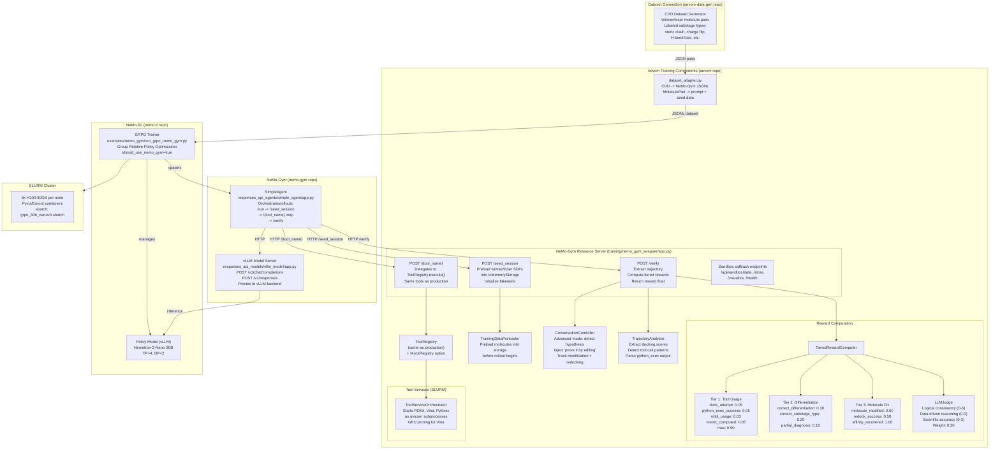
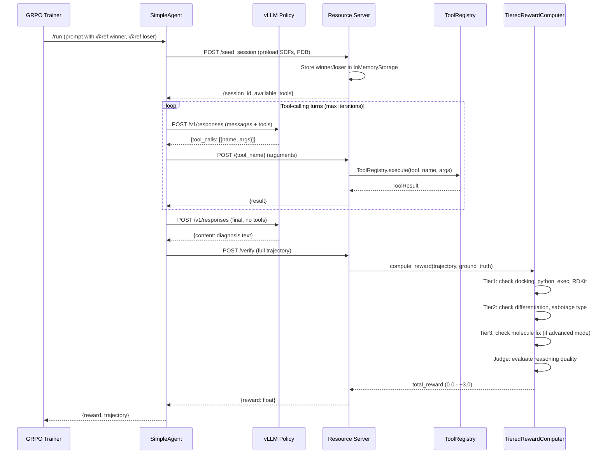

# 5. Training Pipeline

End-to-end GRPO training flow across three repositories: `aevom-data-gen`, `aevom`, `nemo-gym`, and `nemo-rl`.

## Training Architecture

## Training Episode Flow

## Training vs Production Comparison

| Component | Production (K8s) | Training (SLURM) |
|-----------|-----------------|-------------------|
| **LLM** | NVIDIA LLM API (cloud) | Local vLLM (Nemotron-3-Nano-30B) |
| **Orchestration** | LangGraph StateGraph | NeMo-Gym SimpleAgent |
| **Tool Registry** | `ToolRegistry` (shared) | `ToolRegistry` (same code) |
| **Storage** | PostgreSQL + Redis | InMemoryDataArtifactRepository + fakeredis |
| **Tool Services** | Docker containers (rdkit, pyexec, vina) | ToolServiceOrchestrator (uvicorn subprocesses) |
| **Database** | PostgreSQL 16 | None (in-memory) |
| **Frontend** | React SPA + Molstar | None |
| **Deployment** | Kubernetes | SLURM + Pyxis/Enroot |
| **Hardware** | Cloud GPUs | 8x H100-80GB per node (TP=4, DP=2) |

## Source References

- `training/nemo_gym_wrapper/app.py` -- resource server (extends `SimpleResourcesServer`), seed_session, tool execution, verify, sandbox endpoints, fakeredis patching
- `backend/api/training/rewards.py` -- `TieredRewardComputer`, `REWARD_CATALOG`, `DEFAULT_REWARD_CONFIG`, tier1/2/3 computation
- `backend/api/training/judge.py` -- `LLMJudge`, scoring rubric (logical consistency, data-driven, scientific accuracy), YAML-configurable prompts
- `backend/api/training/conversation_controller.py` -- `ConversationController`, hypothesis detection patterns, injection prompt, advanced mode tracking
- `backend/api/training/tool_detector.py` -- `TrajectoryAnalyzer`, docking score extraction, tool call pattern detection
- `backend/api/training/dataset_adapter.py` -- `MoleculePair`, CDD-to-JSONL conversion, `generate_reference_id` reuse
- `backend/api/training/data_preloader.py` -- `TrainingDataPreloader`, molecule preloading into storage
- `training/tool_service_orchestrator.py` -- `ToolServiceOrchestrator`, starts tool services as uvicorn subprocesses with GPU pinning
- `nemo-rl/examples/nemo_gym/run_grpo_nemo_gym.py` -- GRPO training entry point
- `nemo-gym/responses_api_agents/simple_agent/app.py` -- SimpleAgent rollout orchestration
- `nemo-gym/responses_api_models/vllm_model/app.py` -- vLLM model server (`/v1/responses`, `/v1/chat/completions`)
- `training/slurm/grpo/grpo_30b_nanov3.sbatch` -- SLURM job script for 30B GRPO training
