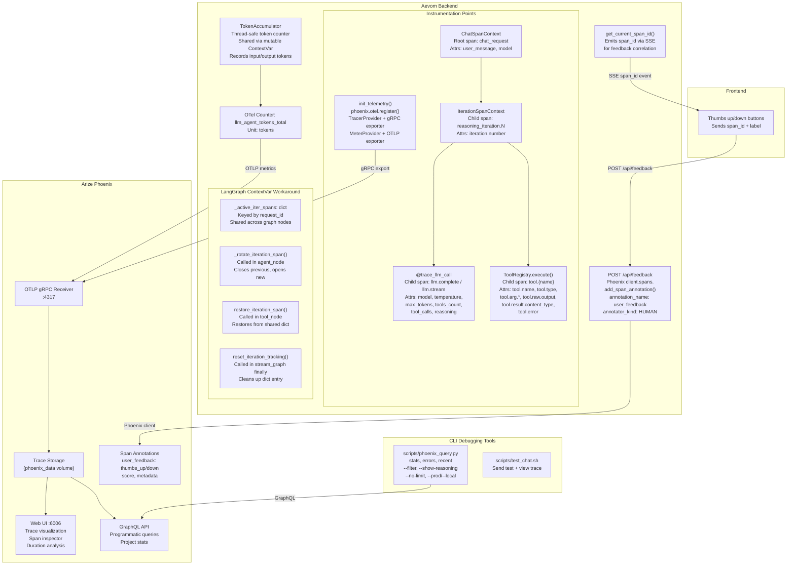
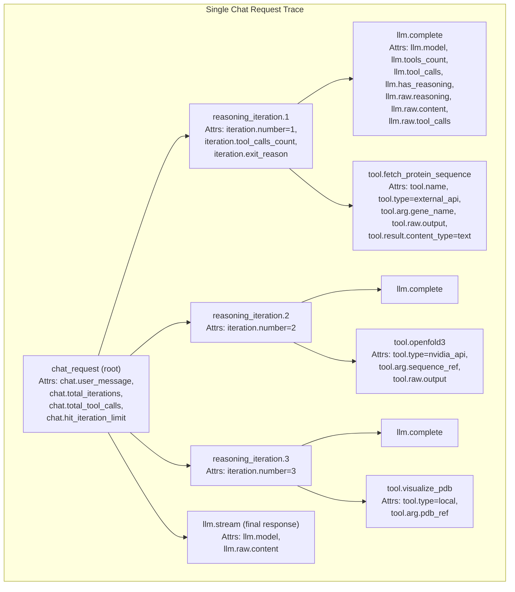

# 6. Observability

OpenTelemetry instrumentation, Arize Phoenix trace collection, span hierarchy, metrics, and feedback annotations.

## Telemetry Architecture

## Span Hierarchy

## Span Attribute Reference

### Chat Request Span

| Attribute | Type | Description |
|-----------|------|-------------|
| `chat.user_message` | string | Full user message (no truncation) |
| `chat.total_iterations` | int | Total reasoning iterations |
| `chat.total_tool_calls` | int | Total tool calls made |
| `chat.hit_iteration_limit` | bool | Whether max iterations (20) was reached |
| `llm.model` | string | Model name |

### LLM Spans

| Attribute | Type | Description |
|-----------|------|-------------|
| `llm.model` | string | Model name (e.g., `nvidia/nemotron-3-nano-30b-a3b`) |
| `llm.temperature` | float | Temperature used |
| `llm.max_tokens` | int | Max tokens setting |
| `llm.tools_count` | int | Number of tools provided |
| `llm.tool_calls_count` | int | Number of tools requested |
| `llm.tool_calls` | string | Comma-separated tool names |
| `llm.has_reasoning` | bool | Whether reasoning content returned |
| `llm.raw.reasoning` | string | Full reasoning/thinking content |
| `llm.raw.content` | string | Full response content |
| `llm.raw.tool_calls` | string | Full JSON of tool calls |

### Reasoning Iteration Spans

| Attribute | Type | Description |
|-----------|------|-------------|
| `iteration.number` | int | 1-based iteration number |
| `iteration.messages_count` | int | Messages in context |
| `iteration.tool_calls_count` | int | Tools called this iteration |
| `iteration.reasoning_length` | int | Length of reasoning content |
| `iteration.exit_reason` | string | `no_tool_calls` or `limit` |

### Tool Spans

| Attribute | Type | Description |
|-----------|------|-------------|
| `tool.name` | string | Tool name |
| `tool.type` | string | `local`, `container`, `nvidia_api`, `external_api` |
| `tool.data_io_category` | string | `text_only`, `output_stores`, `input_retrieves`, `both` |
| `tool.arg.{key}` | string | Tool arguments (truncated at 500 chars for UI) |
| `tool.raw.arguments` | string | Full JSON arguments (no truncation) |
| `tool.raw.output` | string | Full tool output (no truncation) |
| `tool.result.content_type` | string | Result type (text, sdf_3d, error, etc.) |
| `tool.result.success` | bool | Whether execution succeeded |
| `tool.error` | string | Error message if failed |
| `tool.source` | string | `builtin` or `mcp` |
| `tool.adapted` | bool | Whether MCP tool was adapted |

## Metrics

| Metric | Type | Unit | Description |
|--------|------|------|-------------|
| `llm_agent_tokens_total` | Counter | tokens | Cumulative LLM tokens consumed (input + output) |

## Source References

- `backend/api/telemetry.py` -- `init_telemetry()`, `ChatSpanContext`, `IterationSpanContext`, `trace_llm_call()`, `trace_tool_execution()`, `TokenAccumulator`, `get_current_span_id()`, `flush_spans()`
- `backend/api/graph/agent.py` -- `_active_iter_spans` dict, `_rotate_iteration_span()`, `restore_iteration_span()`, `reset_iteration_tracking()`
- `backend/api/graph/streaming.py` -- `ChatSpanContext` usage, span_id emission via SSE
- `backend/api/tools/registry.py` -- `ToolRegistry.execute()` span creation, `should_skip_tool_spans()` for training
- `backend/api/main.py` -- `POST /api/feedback` -> Phoenix `client.spans.add_span_annotation()`
- `scripts/phoenix_query.py` -- CLI for querying Phoenix traces via GraphQL
