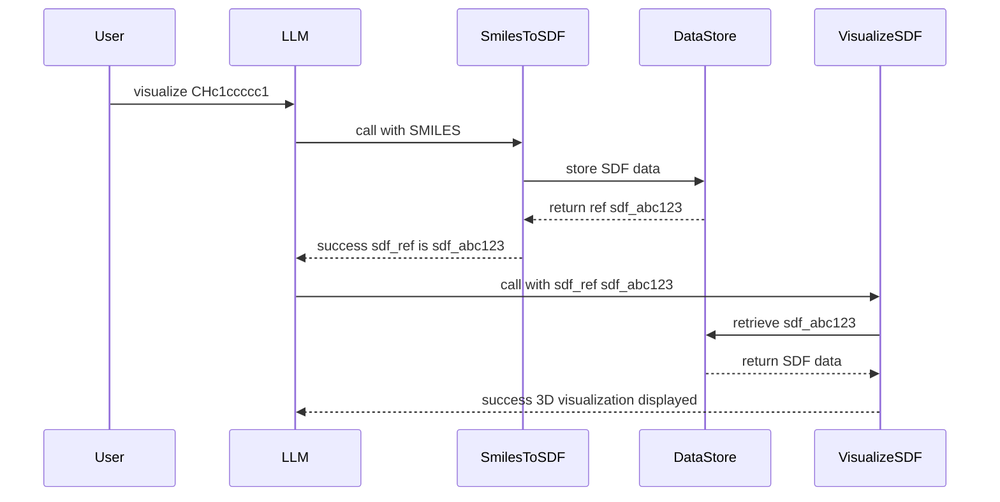

# Data Storage Pattern for LLM Tool Calls

## Background

Aevom uses LLM tool calling to orchestrate molecular science workflows. As tools become more sophisticated, they will generate and consume large data objects (e.g., SDF files, PDB files, docking results). Passing this data directly to the LLM is problematic because:

1. **Token waste**: Large molecular data files consume significant context tokens
2. **LLM confusion**: Raw binary/text formats like SDF are not meant for LLM interpretation
3. **Sequencing complexity**: When chaining tools (e.g., `smiles_to_sdf` then `visualize_sdf`), the LLM shouldn't need to relay the actual data

### Canonical Use Case

Consider a user request: "Visualize this SMILES string: CHc1ccccc1"

With two tools (`smiles_to_sdf` and `visualize_sdf`), the correct flow is:



### Core Principles

1. **Data never flows through the LLM** - Tools store outputs and accept references as inputs
2. **References are opaque identifiers** - e.g., `sdf_abc123`, `pdb_xyz789`
3. **Tool schemas must indicate reference parameters** - So LLMs know which parameters are references vs. raw values
4. **Descriptive messages guide the LLM** - Tool responses include human-readable context explaining what was stored and how to use the reference

### Tool Classification

Every tool falls into one of four categories:

| Category        | Input                     | Output                        | Example         |
| --------------- | ------------------------- | ----------------------------- | --------------- |
| Text-only       | Natural text              | Natural text                  | `molecule_info` |
| Output-stores   | Natural text              | Stores data, returns ref      | `smiles_to_sdf` |
| Input-retrieves | Takes ref, retrieves data | Natural text or visualization | `visualize_sdf` |
| Both            | Takes ref, retrieves data | Stores data, returns ref      | `dock_ligand`   |

---

## Implementation Plan

### 1. Create DataStore Model and Repository

Add a new SQLAlchemy model to [backend/api/db/models.py](backend/api/db/models.py) for persisting tool data artifacts:

```python
  class DataArtifact(Base):
      __tablename__ = "data_artifacts"

      id: Mapped[str] = mapped_column(String(64), primary_key=True)  # e.g., "sdf_abc123"
      data_type: Mapped[str] = mapped_column(String(32))  # e.g., "sdf", "pdb", "mol2"
      content: Mapped[bytes] = mapped_column(LargeBinary)
      metadata_json: Mapped[dict] = mapped_column(JSONB, default=dict)
      created_at: Mapped[datetime] = mapped_column(DateTime, server_default=func.now())
      expires_at: Mapped[Optional[datetime]] = mapped_column(DateTime, nullable=True)
```

Add a repository class for CRUD operations on data artifacts.

### 2. Create DataStore Service

Create a new service module at `backend/api/storage/` with:

- **Reference generation**: Generates typed refs like `sdf_abc123`, `pdb_xyz789`
- **Store operation**: `store(data_type, content, metadata) -> reference`
- **Retrieve operation**: `retrieve(reference) -> content`
- **Delete operation**: `delete(reference) -> bool`
- **TTL support**: Optional expiration for temporary data

### 3. Extend Tool Base Classes

Update [backend/api/tools/base.py](backend/api/tools/base.py):

- Add `DataIOCategory` enum: `TEXT_ONLY`, `OUTPUT_STORES`, `INPUT_RETRIEVES`, `BOTH`
- Add `data_io_category` property to `BaseTool`
- Add helper methods for tools to easily store/retrieve data
- Update `ToolResult` to support reference-based responses

### 4. Update Tool Schemas for Reference Parameters

Establish a schema convention where reference parameters are marked with a custom field. Example:

```python
"parameters": {
    "type": "object",
    "properties": {
        "sdf_ref": {
            "type": "string",
            "description": "Reference to stored SDF data (e.g., 'sdf_abc123')",
            "x-aevom-reference": {"data_type": "sdf"}  # Custom extension
        }
    }
}
```

### 5. Refactor Existing Tools

Update [backend/api/tools/visualization.py](backend/api/tools/visualization.py):

- `Generate3DCoordinatesTool`: Change to store SDF and return reference
- `Visualize3DTool`: Change to accept `sdf_ref` parameter and retrieve data internally

### 6. Add Database Migration

Create Alembic migration for the new `data_artifacts` table.

---

## Files to Create/Modify

| File                                 | Action                                    |
| ------------------------------------ | ----------------------------------------- |
| `backend/api/storage/__init__.py`    | Create - exports                          |
| `backend/api/storage/service.py`     | Create - DataStore service                |
| `backend/api/storage/repository.py`  | Create - DataArtifactRepository           |
| `backend/api/db/models.py`           | Modify - add DataArtifact model           |
| `backend/api/tools/base.py`          | Modify - add data IO category and helpers |
| `backend/api/tools/visualization.py` | Modify - refactor to use storage pattern  |
| `backend/api/main.py`                | Modify - inject storage service           |
| Alembic migration                    | Create - data_artifacts table             |

---

## Extending the Pattern to Runtime-Added Capabilities

Built-in tools are wrapped by hand: the author knows `openfold2` takes a sequence
and an MSA and returns a PDB, so the tool declares `sequence_ref`, `msa_ref`, and
stores its output. Users can also add capabilities at runtime, and those arrive
with no such declaration. There are three paths, each recovering the missing type
information a different way.

### The data type vocabulary

`backend/api/storage/datatypes.py` is the single declaration of every storage
type. A reference is `{data_type}_{hex}`, so this string is the most load-bearing
identifier in the subsystem; it used to be duplicated as bare literals in the MCP
detector, the MCP adapter's LLM-facing wording, the export encoder (twice), and
the sandbox MIME map, which had drifted apart from each other.

Each type declares a friendly name (used in tool schemas and result messages), a
MIME type (served by the sandbox data endpoint), and `is_text`. That last flag is
the important one: text types round-trip through UTF-8, binary types are
base64-encoded on export and require the sandbox's `content_base64` field.
Unknown types are treated as binary, so an unrecognized type is base64-encoded
rather than raising a `UnicodeDecodeError` partway through an export.

### When one notation is a subset of another: SAFE vs SMILES

Most types are self-evident from their payload — a PDB file does not look like a
FASTA sequence. SAFE breaks that. A SAFE string is a dot-separated sequence of
fragments that is *itself valid SMILES*, so no amount of content inspection can
tell the two apart, and the tool schemas make it worse: GenMol's request field is
named `smiles` and requires SAFE in it.

SAFE still needs its own type, because the two are not interchangeable in the
direction that matters. Generative models trained on SAFE depend on the fragment
ordering; give one a plain SMILES and it accepts the string and produces worse
molecules. Nothing raises, nothing logs, and the run looks fine. A separate type
is what turns that into a visible mismatch — and it is why the tool chain has
explicit `smiles_to_safe` / `safe_to_smiles` steps rather than treating the
conversion as an implementation detail.

Two mechanisms resolve the ambiguity, neither of them content sniffing:

- **Detector ordering.** `safe` is declared before `smiles` in
  `HEAVY_TYPE_PATTERNS`. Matching stops at the first pattern clearing its
  threshold rather than taking the highest score, so a field named `smiles` and
  documented as "SAFE notation" matches `safe` on description alone (0.5) instead
  of `smiles` on name and description (1.0). A plain SMILES parameter has no SAFE
  wording and still lands on `smiles`.
- **Case-sensitive `\bSAFE\b`.** The pattern compiler defaults to
  `re.IGNORECASE`, under which that token would fire on "safe to retry" and claim
  every parameter in the schema. Only the unambiguous multi-word forms
  (`safe-smiles`, `safe notation`, the spelled-out
  `sequential attachment-based fragment embedding`) keep IGNORECASE.

The one usable content signal is GenMol's generation mask, `[*{20-30}]`, which is
not valid SMILES. Everything without a mask correctly falls through to the SMILES
extractor.

The `friendly` string in `DATA_TYPE_INFO` is doing real work for this type, not
just display: `_data_type_help()` puts it in the skill contract extraction
prompt, so naming GenMol and SAFE-GPT there is how the model learns to pick
`safe` over `smiles` for a GenMol-shaped field.

### MCP servers: regex detection

An MCP server publishes JSON Schemas but says nothing about which string fields
carry molecular data. `api/mcp/detector.py` matches parameter names and
descriptions against a pattern library, one entry per data type, and
`api/mcp/adapter.py` rewrites the matching parameters into `*_ref` form. Pattern
order matters: `mmcif` is declared before `pdb` because mmCIF documentation
routinely says "mmCIF file from the PDB", and `dna`/`msa` before `sequence`
because a field named `sequence` whose description says "DNA sequence" is not a
protein. Every pattern's `data_type` must exist in `datatypes.py`; a drifted type
would produce artifacts with no MIME type and no text/binary classification.

### Skills: a per-skill synthesized tool

A skill is prose. Its `SKILL.md` describes an HTTP API in English and tells the
model to build the request itself with `http_request` and read raw fields out of
the response — which puts sequences and structures straight into context. A
**contract** (`api/skills/contract.py`) is the missing machine-readable part: for
each endpoint, which request fields carry heavy data, where they sit in the body,
and where the interesting values sit in the response. Given a contract,
`api/skills/endpoint_tool.py` synthesizes a real tool whose parameters are
references.

`json_path` uses a deliberately tiny subset of JSONPath — dot-separated keys with
optional `[i]` indices, e.g. `$.structures[0].structure`. Skill endpoints address
plain JSON bodies, so filters and wildcards would mean writing an evaluator with
no caller.

A contract arrives one of two ways:

- **declared**: an `endpoints:` block in the `SKILL.md` frontmatter. Written
  deliberately by the skill author, so it is trusted and auto-confirmed.
- **extracted**: inferred from the prose by a model at install time
  (`api/skills/extract.py`). It is validated through the same Pydantic models as
  a declared contract, so a hallucinated field or data type is rejected rather
  than executed, and it comes back `confirmed=False`.

Confirmation is the consent gate. An unconfirmed contract synthesizes nothing,
because approving it also authorizes outbound requests — carrying the user's
stored API key — to the hosts it names. The install UI shows the endpoint, the
hosts being authorized, and the editable input/output mapping.

`api/tools/http_common.py` holds the one security surface both `http_request` and
the synthesized tools use: host allowlist, SSRF guard, redirects refused (a
redirect could bounce an allowlisted host to an arbitrary one, carrying the
injected credential), bounded timeout, capped response, and secrets resolved by
name so they never appear in the tool call the model produced. `http_request`
stays available as a soft escape hatch; prose steers the model to the synthesized
tool rather than blocking the generic one.

Registering the tool is not enough on its own. The skill's own prose still says
to hand-build the request, and a model acts on the first applicable instruction
it reads, so `api/skills/annotate.py` repeats the announcement at all three
disclosure levels: a `[has tools: ...]` marker on the always-in-context catalog
line, a `READ FIRST` banner prepended to the `load_skill` body that maps each
response field the prose names onto the reference returned instead, and a
one-line reminder on each bundled resource.

### Auxiliary numeric output: the `array` type

Not every useful output is a first-class type. Boltz-2 returns PAE matrices,
folding models return per-residue pLDDT. Discarding them loses the only copy;
putting them in context is thousands of tokens of numbers the model cannot use.
So a skill endpoint stores any numeric, array-shaped response field that no
declared output claimed as an `array` artifact (compressed `.npz`), and reports
the reference. From there `python_execute` is the right consumer:

```python
pae = aevom.load_array("array_abc123")
print(pae.shape, pae.mean())
interface = pae[:120, 120:]
ref = aevom.store_array(interface, description="Chain A/B interface PAE")
```

`array` is the only binary type in the vocabulary. Arrays are loaded with
`allow_pickle=False`, which is a security boundary and not a formality: an object
array would otherwise execute arbitrary code on load.
