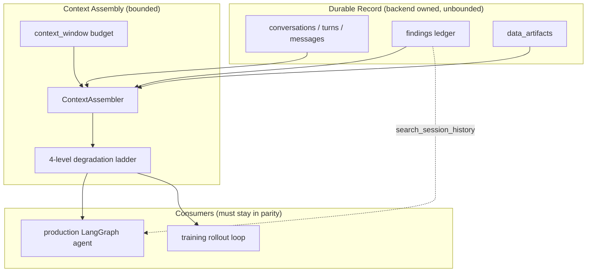

# Agentic Memory and Context Architecture

How Aevom remembers what it has done, and how it decides what to show the model.

## Audience

- **System architects** evaluating the design: start with [The organizing idea](#the-organizing-idea) and [Why not the obvious alternatives](#why-not-the-obvious-alternatives).
- **Aevom engineers** changing this code: [Layer reference](#layer-reference) and [Invariants](#invariants-do-not-break-these) are the parts you will need before touching anything.
- **Agents working on Aevom**: [Invariants](#invariants-do-not-break-these) and [Where things live](#where-things-live) are the load-bearing sections. Read the invariants before proposing a change to the ladder or the envelope.
- **Engineers building something similar**: the design generalizes only partway, and [What transfers and what does not](#what-transfers-and-what-does-not) says which half.

---

## The organizing idea

Before this architecture, the conversation record and the model's context were the same object. Because they were the same object:

- The record could only be as long as the context window allowed.
- The frontend owned both, and it kept only `role` and `content`, so tool calls, tool results, and reasoning were discarded between user turns.
- Any attempt to bound the context necessarily destroyed the record.

The architecture splits them in two:

- The **backend owns a durable, queryable record** of everything that happened.
- A separate **explicit assembler renders a view** of that record into a prompt, under a declared token budget.



### The domain advantage

Most agent memory systems must summarize prose, and accept the loss and the hallucination risk that comes with it. Aevom does not have to.

A dock produces a number. A fold produces pLDDT and ipTM. Both produce references into an artifact store that already exists. Those are **facts**, and facts can be recorded once and re-rendered deterministically — no model call, no hallucination, no per-request latency.

That is why the centerpiece of this design is a typed ledger rather than a summarizer. The three lines below are permanent, cost nothing to produce, and are what make "re-dock that ligand to recover the -9.5 we measured twenty iterations ago" unnecessary:

```
[SESSION LOG]
T1.2 vina_dock(ligand=sdf_a1b2c3d4, receptor=pdb_b2c3d4e5) -> -9.50 kcal/mol [sdf_c3d4e5f6]
T1.4 vina_dock(ligand=sdf_d4e5f6a7, receptor=pdb_b2c3d4e5) -> -6.10 kcal/mol [sdf_e5f6a7b8]
T2.1 molecule_info(sdf_d4e5f6a7) -> MW 412.5, LogP 4.8, TPSA 62.3
```

---

## Layer reference

The system is seven layers. Layers 0–2 build the record; 3–5 render and retrieve from it; 6 was measured and deliberately not built.

### Layer 0 — The conversation record lives server-side

Four tables in [backend/api/db/models.py](../backend/api/db/models.py), keyed on the `session_id` minted by `/api/session/create`:

| Table | Holds | Notable columns |
| --- | --- | --- |
| `conversations` | One transcript | `session_id`, `model_id` |
| `turns` | One user message plus the agent's whole response | `seq` (1-based, drives `T{turn}` numbering) |
| `messages` | Every message, with everything the model produced | `reasoning`, `tool_calls`, `tool_call_id`, `extra` |
| `findings` | One row per tool execution | `scalars`, `input_refs`, `output_refs`, `summary` |

The `messages` columns are the point: `reasoning`, `tool_calls`, and `tool_call_id` are exactly the fields the frontend used to drop.

**API contract.** `POST /api/chat` takes `session_id` plus only the new user message. `GET /api/conversation/{session_id}` returns the transcript and findings; the frontend renders from that rather than owning history. The old whole-transcript `messages` field is still accepted for eval harnesses and scripts, and ignored when `message` is set.

**Model switching.** A switch starts a new conversation against the same session. Artifacts and findings carry across because chemistry is model-independent; the transcript starts fresh because chat templates and tokenizers are not.

**Ephemerality.** `conversations`, `turns`, `messages`, and `findings` are dropped and recreated on backend restart, alongside `data_artifacts`. This is not convenience — transcripts and findings name artifact references, so keeping a transcript whose refs have been dropped would leave the model reading about data it can no longer load.

**Recording is incremental**, not end-of-run. [`TurnRecorder`](../backend/api/conversations/recorder.py) takes a short-lived DB session per write and commits. A user who interrupts a long tool chain still leaves behind everything that happened up to that point — which is precisely the trajectory the next turn needs. Every method swallows its own failures: a dock that ran is worth more than the row describing it.

### Layer 1 — Cap tool output at the choke point

Every tool result funnels through one function, and it had no length bound. The storage pattern kept SDF and PDB payloads out of context, but a tool that *returns text* — `python_execute` printing a coordinate array, `load_skill` returning a document body — was exempt.

The budget in [backend/api/tools/base.py](../backend/api/tools/base.py) applies the same storage pattern to text: overflow becomes an artifact, and the model gets a head/tail preview plus the reference and a pointer to read it with `python_execute`.

| Tool | `max_response_tokens` | Why |
| --- | --- | --- |
| default | 2000 | |
| `python_execute` | 800 | Sandbox output is arbitrary by nature |
| `load_skill`, `load_skill_resource` | 1200 | Author-controlled prose of unbounded length |

The head gets 60% of the surviving budget: tool output is front-loaded, but the tail usually holds the summary line the model actually wants.

The cap is applied in `ToolRegistry`, not in the tool, and writes to `ToolResult.response_override` rather than mutating `data`. Visualization, training export, and telemetry (`tool.raw.output`) all continue to see the uncapped result.

### Layer 2 — The findings ledger

Written by `ToolRegistry._record_finding` after every tool execution, success or failure. Extraction lives in [backend/api/conversations/findings.py](../backend/api/conversations/findings.py) and is mostly plumbing, because the Vina and OpenFold3 tools already parse these values into `metadata`.

Canonical scalars: `affinity_kcal_mol`, `plddt`, `iptm`, `ptm`, `confidence`, `molecular_weight`, `logp`, `tpsa`. Several source keys map onto one canonical name — OpenFold3's API and the viewer metadata disagree, and the ledger normalizes.

Rendered scalars carry units. `-9.5` on its own invites the model to compare it against a pLDDT.

Two subtleties worth knowing:

- **`python_execute` announces its artifacts in its own text and nowhere else.** It is the main way references come into existence, so the extractor scans successful tool output for reference patterns. It does *not* scan failed output — a reference named in an error message is not an output that exists.
- **`search_session_history` is excluded from the ledger** (`_NOT_FINDINGS` in [registry.py](../backend/api/tools/registry.py)). Recording a search as a finding makes it findable by the next search, so the ledger fills with echoes of itself and the session log fills with them too. This was found in live testing, not unit tests.

### Layer 3 — Budgeted context assembly

[`ContextAssembler`](../backend/api/context/assembler.py) replaces the old `build_state_modifier`, keeping the same call signature so `agent_node` is unchanged.

**Fill order.** A fixed floor first — system prompt, tool schemas, state envelope, session log — then the current user message and the turn in progress, then earlier turns newest to oldest.

The session log lives in the floor for a specific reason: it holds every number the session measured, so degrading the trajectory below it cannot lose a measurement, only the prose around it.

**The ladder.** Content is degraded, not dropped:

| Level | Name | What the model sees |
| --- | --- | --- |
| 0 | `LEVEL_VERBATIM` | The message as it was |
| 1 | `LEVEL_PREVIEW` | First 400 chars of each tool result, plus its artifact refs and a pointer to `python_execute` |
| 2 | `LEVEL_COLLAPSED` | Each call and result reduced to one line: first line plus refs |
| 3 | `LEVEL_SUMMARY` | The whole turn as its finding lines plus its closing assistant text; no tool calls survive |

Escalation is oldest-first within a level before moving to the next level, so a small overrun costs a little context from the oldest turn rather than flattening everything.

At level 1 the **reference matters more than the text**. A model that can still see `pdb_c3c3c3c3` can pass it to another tool or read it with `python_execute`; a model shown 400 characters of a PDB file can do neither.

Level 2 is safe to be this aggressive *because* the `[SESSION LOG]` in the floor holds the scalars verbatim. What is dropped is prose, not measurement.

**Budget.** `context_window - max_tokens - CONTEXT_SAFETY_MARGIN_TOKENS (2048) - tool schema cost`. Bound tool schemas go out on every call, so they are charged. A model that declares no `context_window` yields no budget, and assembly degenerates to "build the prompt and send it" — deliberately distinct from a computed budget of zero, which means the floor alone consumed the window and is a real problem worth reporting.

**Estimation** is `chars / 3.5` plus 4 tokens per message of wire framing. Calibrated against the provider's own `usage.prompt_tokens`: live sessions run at ratio 1.005–1.02, i.e. slightly *over*-counting, which is the safe direction. The original 4.0 under-counted by ~11.5% and was corrected from telemetry.

**Performance.** The fit loop tracks a running total and adjusts by deltas rather than re-measuring the whole prompt per step, and rendering is memoized per exchange per level. Re-measuring is quadratic in turns; with tool results running to tens of kilobytes that is the difference between assembly costing microseconds and seconds. There is a regression test that fails if this returns.

### Layer 4 — Retrieval instead of bigger caps

The state envelope shows 20 artifacts and 40 findings, then says "and N more". Raising those caps only moves the cliff — the envelope has to stay small or it eats the budget it exists to protect.

[`search_session_history`](../backend/api/tools/session_history.py) removes the cliff instead, and the truncation notices name it rather than dead-ending.

```
search_session_history(query=None, tool=None, data_type=None, limit=15)
```

Searches the findings ledger and the artifact store. Ranked by PostgreSQL `word_similarity` from `pg_trgm` — **not** `similarity`, which scores near zero when a short query is compared against a whole summary line. `word_similarity` scores the query against the best-matching run of words inside the summary, which is the question actually being asked. Threshold 0.45; substring match is OR'd in so an exact phrase matches regardless of how the fuzzy score lands.

The extension is optional. Availability is *checked*, not attempted, because a failed statement aborts the enclosing transaction in PostgreSQL and "try the fancy query, fall back on error" would take the caller's whole unit of work down with it. Without `pg_trgm`, search degrades to substring matching — narrower, never wrong.

A tool filter with no query returns findings only, not the whole artifact store. Answering "what did openfold3 do" with every artifact in the session would bury the one line asked for, which is the exact failure the envelope cap exists to prevent.

**No vector database.** These are structured records, a session holds tens to hundreds, and a SQL predicate is precise and auditable in Phoenix in a way a vector neighbourhood is not. Revisit only if measurement shows structured search failing.

### Layer 5 — Structured sub-agent returns

The four workflow subgraphs (small molecule, structure prediction, docking, protein-ligand) are the best context mechanism in the system: each starts a fresh `[HumanMessage(query)]`, so the child's trajectory never touches the parent's.

`_run_subgraph` returns `{summary, artifacts_created, findings}` rather than a single string, so the child's findings land in the parent's ledger instead of being flattened into prose. `_render_subgraph_result` formats that for the parent with the summary, the artifacts created, and a "Measured during this workflow" section.

### Layer 6 — Anchored compaction: measured, not built

The plan made LLM-written compaction conditional on the ladder proving insufficient. It was measured against `nemotron-3-super-rc-nim` (131,072 window, 32,768 reserved for generation, ~20.7k floor) in the worst case: every turn running all `MAX_ITERATIONS` agent iterations, every tool result saturating its 2000-token cap.

Re-measured after `MAX_ITERATIONS` was raised from 20 to 50:

| turns | iterations/turn | level reached | estimated | available | over budget |
| ---: | ---: | ---: | ---: | ---: | --- |
| 1 | 20 | 0 | 46,737 | 75,504 | no |
| 1 | 50 | 2 | 73,413 | 75,504 | no |
| 2 | 50 | 3 | 74,292 | 75,504 | no |
| 10 | 50 | 3 | 74,466 | 75,504 | no |
| 50 | 50 | 3 | 75,386 | 75,504 | no |
| 100 | 50 | 3 | 91,954 | 75,504 | **yes** |

The ladder still holds, but with materially less headroom than at 20 iterations, where the same measurement survived 150 turns. Two consequences worth knowing:

- A single maximal 50-iteration turn now degrades *itself* to level 2 to fit, where a 20-iteration turn was sent verbatim. This is the designed behavior — the assembler collapses all but the most recent exchange of the current turn — but it means the trajectory the model sees during a long turn is compressed rather than complete.
- The breaking point moved from between 150 and 200 turns down to between 50 and 100.

Real sessions measured in Phoenix sit at 22% of budget, so this is a worst-case bound rather than an operational one.

Compaction would also buy less than it appears. At level 3 a turn is already reduced to its findings plus one closing sentence, and findings are exactly what anchored compaction preserves verbatim — so the only thing left to compress is that one sentence of narrative per turn.

**`context.still_over_budget` is the signal that this conclusion has expired.** It is emitted even at degradation level 0, which is the case where a single message is itself larger than the window: nothing degraded, and the call is about to fail.

---

## Reasoning retention

Nemotron models reason in plain text and return it via `reasoning_content`. That train of thought was being thrown away in production while training already consumed it — the trained policy saw its own chain of thought and the deployed one did not.

`ModelConfig.retains_reasoning` (per model, on for the Nemotron family) causes `_langchain_to_openai_messages` in [backend/api/graph/llm.py](../backend/api/graph/llm.py) to emit reasoning back on the assistant message. Models whose clients split reasoning out of `content` via `</think>` tags are re-attached through that path instead, without double-emitting the delimiter.

Left off for Gemini 3 initially: `requires_thought_signatures` already drives special `provider_specific_fields` handling and strict validation, and perturbing it risks 400s.

Reasoning is subject to the same ladder as everything else, and degrades first — it is the least load-bearing content once a finding exists.

---

## Training parity

**This is a hard constraint, not an aspiration.** Every layer here changes the observation distribution the policy is trained on. Shipping one to production alone means the deployed agent sees a world the trained agent never did.

| Layer | Mechanism | Parity |
| --- | --- | --- |
| 1 — tool output cap | Shared `ToolRegistry` | Automatic |
| 2 — findings ledger | Shared `extract_finding`; training keeps rows on `SessionState` | Same extraction, different store |
| 3 — degradation ladder | `assembler.py` (LangChain) and `responses.py` (Responses API) share the transforms | Same policy, two message shapes |
| 4 — session search | Recorder→PostgreSQL in production; `set_findings_source`→in-process list in training | Same tool, two backends |
| 5 — subgraph returns | Production only (training has no subgraphs) | N/A |
| Reasoning retention | Training already retained it; this closed the gap | Now aligned |
| 0 — server-side record | Production only until the training task grows a real second user turn | Deferred |

Two details make this work:

**The state envelope is one function.** Both sides call `inject_state_into_prompt` in [backend/api/state/format.py](../backend/api/state/format.py). The training agent strips from `INJECTION_SENTINEL` before re-injecting each turn, so the envelope refreshes rather than stacking. The envelope must therefore *begin* with that sentinel — a block placed ahead of it survives stripping and accumulates a stale copy every turn.

**Training's window is much smaller than production's, and overflowing it does not raise.** `policy.max_total_sequence_length` is 36,864 against production's 131,072, and NeMo-RL truncates the sequence rather than erroring — the episode silently loses its tail. The sbatch reads that value out of the GRPO YAML into `AEVOM_CONTEXT_WINDOW` so the two cannot drift.

Training episodes are currently single-user-turn (advanced mode front-loads all four steps into the initial prompt), so the ladder there stops at level 2 — there is no earlier turn to summarize. The Responses-API side also only ever rewrites a `function_call_output` in place, never removing an item, so a call structurally cannot lose its result.

---

## Invariants (do not break these)

1. **Never orphan a tool result from its call.** Degradation operates on whole `AIMessage` + `ToolMessage` groups (`Exchange`). An orphaned tool message causes a provider 400 that names neither the message nor the tool, and is much harder to diagnose than the overflow it replaced.
2. **The session log is never degraded.** It lives in the floor. Everything below it is compressible *because* the numbers are safe above it.
3. **Findings key on `session_id`, not `conversation_id`.** They must survive a model switch.
4. **The state envelope begins with `INJECTION_SENTINEL`.** See parity above.
5. **Degrade, do not drop.** Naive sliding-window truncation orphans tool messages and hard-errors.
6. **No LLM call on the assembly hot path.** Latency plus nondeterminism, for something the ledger already does deterministically.
7. **Tools that read the ledger must not write to it.** Add them to `_NOT_FINDINGS`.
8. **Silent degradation is worse than a loud failure.** A model quietly shown half its trajectory looks like a model that got worse. The telemetry is part of the feature.
9. **Any change to layers 1–5 lands in training and production together.**

---

## Telemetry

All on the LLM/chat span in Phoenix.

| Attribute | Meaning |
| --- | --- |
| `context.tokens.used` / `.budget` / `.window` | Estimate, allowance, model capacity |
| `context.tokens.utilization` / `.headroom` | Fraction of budget used; tokens left |
| `context.tokens.actual` / `.estimate_error` / `.estimate_ratio` | Calibration against the provider's `prompt_tokens` |
| `context.over_budget` | Estimate exceeded the allowance |
| `context.degradation_level` | 0–3, highest level the ladder reached |
| `context.messages.degraded` | How many exchanges or turns were degraded |
| `context.assembled.tokens` / `.available` | Post-assembly estimate against what was available |
| `context.still_over_budget` | **Ladder exhausted.** The trigger for reconsidering Layer 6 |
| `tool.response.capped` / `.raw_chars` / `.kept_chars` / `.overflow_ref` | Layer 1 firing, and where the full output went |

`context.tokens.estimate_ratio` is the one to watch routinely. It should sit slightly above 1.0; if it drifts below, `CHARS_PER_TOKEN` is under-counting and the budget is optimistic.

---

## Where things live

| Path | Role |
| --- | --- |
| [backend/api/context/assembler.py](../backend/api/context/assembler.py) | `ContextAssembler`, the ladder, `Exchange` / `Turn` grouping |
| [backend/api/context/budget.py](../backend/api/context/budget.py) | Token estimation, budget checks, calibration telemetry |
| [backend/api/context/responses.py](../backend/api/context/responses.py) | The ladder applied to Responses API input items (training) |
| [backend/api/context/rehydrate.py](../backend/api/context/rehydrate.py) | Stored records → LangChain messages, dropping unpaired blocks |
| [backend/api/conversations/store.py](../backend/api/conversations/store.py) | CRUD and search over transcripts and findings |
| [backend/api/conversations/recorder.py](../backend/api/conversations/recorder.py) | `TurnRecorder`, incremental persistence, request-scoped `ContextVar` |
| [backend/api/conversations/findings.py](../backend/api/conversations/findings.py) | Scalar and reference extraction; in-memory search for training |
| [backend/api/state/format.py](../backend/api/state/format.py) | The shared state envelope, including `[SESSION LOG]` |
| [backend/api/tools/session_history.py](../backend/api/tools/session_history.py) | The `search_session_history` tool |
| [backend/api/tools/base.py](../backend/api/tools/base.py) | Response budget and `max_response_tokens` |
| [backend/api/db/models.py](../backend/api/db/models.py) | `Conversation`, `Turn`, `Message`, `Finding` |
| `training/agents/aevom_simple_agent/app.py` | State injection and ladder in the rollout loop |
| `training/nemo_gym_wrapper/app.py` | Findings on `SessionState`; binds the in-memory search source |

Related reading: [data_storage_pattern.md](data_storage_pattern.md) for the artifact reference pattern this builds on, [view_injection_pattern.md](view_injection_pattern.md) for the state envelope's origins, and [telemetry.md](telemetry.md) for the Phoenix setup.

---

## Why not the obvious alternatives

**A LangGraph checkpointer instead of explicit tables.** Less code, but a checkpointer blob is opaque, and this data must be *queried* — for the ledger, for retrieval, for training export. `AevomState` also carried non-serializable services (`_storage`, `_db_session_factory`); those moved into `config["configurable"]`, which is where they belonged anyway and which leaves the checkpointer available later for resumption.

**A vector database over findings.** Structured records, tens to hundreds per session, typed fields. SQL filtering is more precise and debuggable. Embeddings buy nothing here that trigram matching does not.

**Naive sliding-window truncation.** Orphans tool messages and hard-errors at the provider.

**Summarizing on the hot path.** Latency and nondeterminism, to reproduce what the ledger already gives exactly.

**Raising the artifact and finding caps.** Moves the cliff instead of removing it, and spends the budget the caps exist to protect.

---

## What transfers and what does not

If you are building something similar, the transferable parts are:

- **Splitting the record from the context.** Nearly every "our agent forgets things" problem is really this conflation. It is the single highest-leverage change here and it is domain-independent.
- **Degrading rather than dropping, on whole call/result groups.** The provider-400 failure mode is universal to tool-calling agents.
- **Capping tool output at the registry, not in each tool.** One choke point, and the raw result stays intact for non-model consumers.
- **Measuring before building the expensive layer.** The compaction machinery was scoped, then measured, then not written. The measurement took an afternoon; the layer would have taken a week and paid for itself only past several dozen maximal turns. Re-running that measurement is also what caught the headroom loss when the iteration cap was later raised.

The part that does **not** transfer directly is the ledger's determinism, and it is the part doing the most work here. It depends on your tools producing *typed facts* — a number with a unit, a reference to a stored object. If your tools return prose, you cannot re-render them losslessly and you will need summarization somewhere.

The useful question is not "how do I summarize my history" but "what part of my tool output is a fact, and can I extract it?" In this domain the answer was: almost all of it, and it was already sitting in `metadata`.
