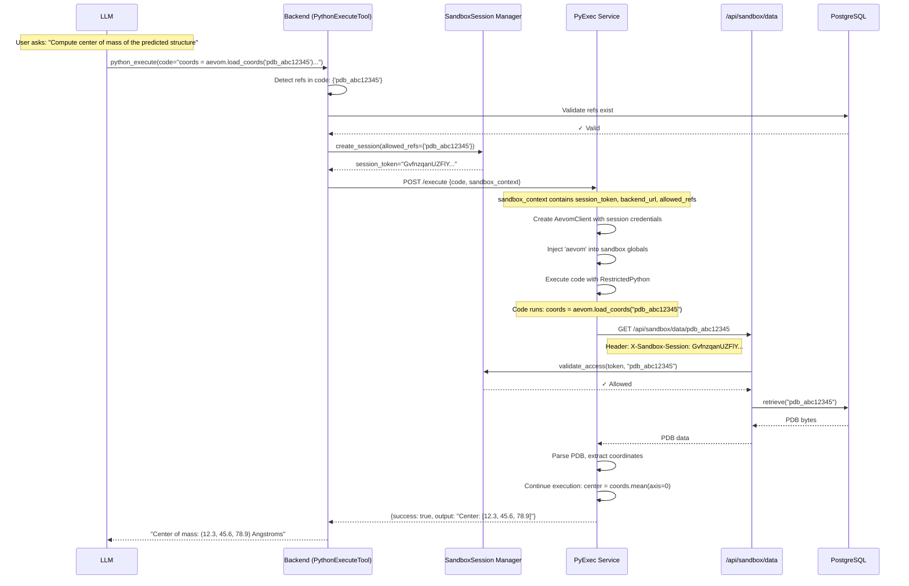
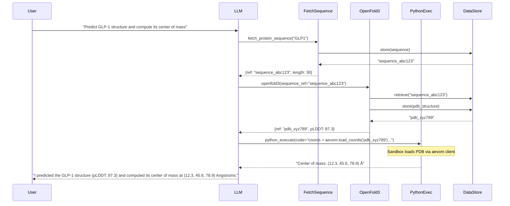

# Python Sandbox Integration

## Introduction

### The Challenge of Heavy Data in LLM-Powered Molecular Design

Large Language Models are transforming computational chemistry by enabling researchers to interact with complex molecular tools through natural language. However, LLMs face a fundamental limitation: they operate on text tokens and struggle with "heavy data"—the large, structured binary and text formats that define molecular science. A single protein structure can contain thousands of atoms with precise 3D coordinates, atomic properties, and residue annotations. Passing such data through an LLM is not only inefficient (consuming precious context tokens) but counterproductive—LLMs are not designed to parse PDB files or manipulate cartesian coordinates directly.

This creates a tension. On one hand, we want the LLM to orchestrate sophisticated computational workflows: predict a protein structure, dock a ligand, analyze binding interactions. On the other hand, the actual molecular data—the coordinates, the chemical structures, the simulation results—must remain outside the LLM's token stream while still being accessible for computation.

Our solution is the **Python Sandbox Integration**—a secure execution environment where LLM-generated Python code can directly load and operate on stored molecular data. When a user asks "compute the center of mass of the predicted GLP-1 structure," the LLM generates Python code that calls `aevom.load_coords("pdb_abc12345")`, and the sandbox executes it with full access to numpy, scipy, and RDKit. The heavy data never flows through the LLM, yet the LLM retains complete computational expressiveness through Python.

### Technical Overview for Engineers

The Python Sandbox Integration extends Aevom's existing [Data Storage Pattern](data_storage_pattern.md) to enable bidirectional data flow between LLM tool calls and sandboxed Python execution. The architecture comprises four key components:

1. **Data Storage Service** (`backend/api/storage/`): Stores molecular artifacts (PDB, SDF, sequences, selections) in PostgreSQL with typed reference IDs (e.g., `pdb_abc12345`). Tools deposit data here and return lightweight references to the LLM.

2. **Sandbox Session Manager** (`backend/api/sandbox/session.py`): Creates ephemeral sessions that scope which data references a sandbox execution can access. Each `python_execute` call receives a unique session token authorizing access to specific references.

3. **Aevom Client** (`services/pyexec/app/aevom_client.py`): A Python module pre-loaded into the sandbox namespace as `aevom`. Provides methods like `load()`, `load_coords()`, and `load_rdkit_mol()` that call back to the backend API to retrieve stored data.

4. **Sandbox Data API** (`backend/api/sandbox/routes.py`): A FastAPI router exposing `GET /api/sandbox/data/{reference}` that validates session tokens, checks reference permissions, and returns raw data bytes.

The sandbox itself uses [RestrictedPython](https://restrictedpython.readthedocs.io/) to compile and execute LLM-generated code with a whitelist of safe modules (numpy, scipy, rdkit) while blocking dangerous operations (file I/O, subprocess, network access beyond the aevom client).

---

## Architecture

### System Components

```
┌─────────────────────────────────────────────────────────────────────────┐
│                              BACKEND                                    │
│  ┌─────────────────┐    ┌──────────────────┐    ┌───────────────────┐   │
│  │ PythonExecute   │───▶│ SandboxSession   │    │ DataStorage       │   │
│  │ Tool            │    │ Manager          │    │ Service           │   │
│  └────────┬────────┘    └──────────────────┘    └─────────┬─────────┘   │
│           │                                               │             │
│           │         ┌──────────────────────┐              │             │
│           │         │ /api/sandbox/data    │◀─────────────┘             │
│           │         │ (Data Retrieval API) │                            │
│           │         └──────────┬───────────┘                            │
└───────────┼────────────────────┼────────────────────────────────────────┘
            │                    │
            ▼                    ▲
┌───────────────────────┐        │
│      PYEXEC SERVICE   │        │
│  ┌─────────────────┐  │        │
│  │ RestrictedPython│  │        │
│  │ Sandbox         │  │        │
│  │  ┌───────────┐  │  │        │
│  │  │  aevom    │──┼──┼────────┘
│  │  │  client   │  │  │  HTTP callback
│  │  └───────────┘  │  │
│  │  + numpy        │  │
│  │  + scipy        │  │
│  │  + rdkit        │  │
│  └─────────────────┘  │
└───────────────────────┘
```

### Data Flow Sequence

The following sequence diagram illustrates the complete flow when the LLM executes Python code that loads stored molecular data:



**Use Case: Computing Center of Mass After Structure Prediction**

Consider a researcher who has just predicted a protein structure using OpenFold3. The prediction tool returned a reference `pdb_abc12345` pointing to the stored PDB file. Now the researcher asks: "What is the center of mass of this protein?"

The LLM generates Python code:

```python
coords = aevom.load_coords("pdb_abc12345")
center = coords.mean(axis=0)
print(f"Center of mass: ({center[0]:.1f}, {center[1]:.1f}, {center[2]:.1f}) Å")
```

Behind the scenes:

1. The `PythonExecuteTool` detects `pdb_abc12345` in the code via regex
2. It validates this reference exists in the data store
3. It creates a sandbox session authorizing access to only this reference
4. PyExec receives the code along with session credentials
5. When `aevom.load_coords()` executes, it makes an authenticated HTTP call back to the backend
6. The backend validates the session token and reference permission
7. The PDB data is retrieved from PostgreSQL and returned
8. The aevom client parses the PDB and extracts coordinates as a numpy array
9. The code computes the center of mass and prints the result
10. The output flows back through the LLM to the user

The heavy PDB data (potentially megabytes) never passed through the LLM—only the lightweight reference ID and the final computed result.

---

## Security Model

### Session-Scoped Access Control

Every `python_execute` call creates an ephemeral sandbox session:

```python
@dataclass
class SandboxSession:
    id: str                    # Unique session token (256 bits)
    allowed_refs: set[str]     # Only these references can be loaded
    created_at: datetime
    expires_at: datetime | None  # Optional TTL
    access_count: int          # Rate limiting counter
    max_accesses: int | None   # Optional access limit
```

The session manager enforces:

- **Reference Validation**: Only references explicitly in `allowed_refs` can be loaded
- **Session Expiration**: Optional TTL to limit session lifetime
- **Rate Limiting**: Optional cap on total data access requests
- **No Cross-Session Access**: Sessions are isolated; one session cannot access another's references

### RestrictedPython Sandbox

The execution environment uses RestrictedPython to compile code with safety guards:

```python
ALLOWED_MODULES = {
    # Standard library - safe subset
    "math", "statistics", "collections", "itertools",
    "functools", "operator", "json", "re", "copy",

    # Scientific computing
    "numpy", "scipy", "scipy.spatial", "scipy.stats", "sklearn",

    # Chemistry
    "rdkit", "rdkit.Chem", "rdkit.Chem.Descriptors", ...
}

FORBIDDEN_ATTRS = {
    "__class__", "__bases__", "__subclasses__", "__globals__",
    "__code__", "__closure__", "__dict__", ...
}

DANGEROUS_PATTERNS = [
    "exec(", "eval(", "open(", "subprocess", "os.system", ...
]
```

Matching is on module **prefixes**, so whitelisting `rdkit` admits the whole
package — `MurckoScaffold`, `rdFMCS`, `FilterCatalog`, `ChemicalFeatures` and
`BRICS` all import without further entries. They are listed explicitly anyway so
that tightening the matcher does not silently remove them.

A package can carry a submodule that reopens what the sandbox exists to close.
`sklearn.datasets` downloads over HTTP and reads arbitrary paths, which is the
surface `open(` and `socket.` are blocked for, so it is denied by name:

```python
BLOCKED_SUBMODULES = {"sklearn": {"datasets", "externals"}}
```

Both routes in have to be closed. `import sklearn.datasets` is caught by the
import hook, but sklearn also resolves submodules lazily on attribute access, so
`sklearn.datasets.fetch_openml` is reachable with no import statement at all and
is caught in `_guarded_getattr`. The same pair of guards covers datamol's `dm`,
reached through `safe.converter`.

The aevom client itself uses `urllib.request` internally (not exposed to user code) to make authenticated callbacks to the backend. User code cannot open sockets, but the whitelisted `pubchempy` and the aevom PubChem and RCSB helpers do reach the public internet. With `PYEXEC_MODE=openshell`, which deployments (`make up`, `make dev`, the Helm chart) use by default, the sandbox's network policy allows only the backend's sandbox routes, PubChem PUG-REST and RCSB search. In direct mode, the backend's own default and what training uses, nothing below RestrictedPython limits where the process can connect. See [openshell_sandbox.md](openshell_sandbox.md).

### Execution and response budgets

`timeout_seconds` defaults to 30 and is capped at 120 for interactive turns, 180
during training rollouts, where a timeout costs a whole episode rather than one
retryable turn. The pyexec service enforces its own ceiling of 180 and rejects
anything higher with a 422, so the caller-side clamps must stay at or below it —
they did not always, and every training call asking for more than 60s failed
before running any code.

Sandbox output is capped below the default tool budget, because its size follows
from what the code prints rather than from the request. Overflow is stored as a
text artifact and the reference is reported, so a large result is truncated rather
than lost. For a descriptor panel over many molecules, `molecule_gates` writes a
CSV artifact instead and is the better tool.

---

## Aevom Client API

The `aevom` client is pre-loaded into every sandbox execution environment. It provides convenient methods for loading different data types:

### Core Methods

| Method                          | Return Type            | Description                              |
| ------------------------------- | ---------------------- | ---------------------------------------- |
| `aevom.load(ref)`               | `str \| dict \| bytes` | Load any data, auto-parse based on type  |
| `aevom.load_pdb(ref)`           | `str`                  | Load PDB structure as text               |
| `aevom.load_sdf(ref)`           | `str`                  | Load SDF molecule as text                |
| `aevom.load_coords(ref)`        | `np.ndarray`           | Extract coordinates as (N, 3) array      |
| `aevom.load_rdkit_mol(ref)`     | `Chem.Mol`             | Parse SDF into RDKit molecule            |
| `aevom.load_pdb_structure(ref)` | `dict`                 | Load PDB with full atom metadata         |
| `aevom.load_selection(ref)`     | `Selection` (dict)     | Load a selection; `.residues()` gives both numbering systems |
| `aevom.store_selection(structure_ref, residues, chain, name, atoms=None)` | `str` | Make a selection from residue numbers (optionally only some atoms, e.g. `"56:OH"` or `atoms="sidechain"`), return its ref |
| `aevom.load_sequence(ref)`      | `dict`                 | Load protein sequence as `sequence`, `length` |
| `aevom.load_array(ref)`         | `np.ndarray`           | Load a numeric array artifact            |
| `aevom.store_array(arr)`        | `str`                  | Store a numeric array, return a ref      |

### Type-Specific Parsing

The `load()` method automatically parses data based on the reference prefix:

| Prefix        | Data Type        | Return Type                            |
| ------------- | ---------------- | -------------------------------------- |
| `pdb_*`       | PDB structure    | `str` (PDB format text)                |
| `sdf_*`       | SDF molecule     | `str` (SDF format text)                |
| `sequence_*`  | Protein sequence | `str` (one-letter residue codes)       |
| `selection_*` | MolQL selection  | `dict` with `atoms`, `coords`, etc.    |
| `mmcif_*`     | mmCIF structure  | `str` (mmCIF format text)              |
| `array_*`     | Numeric array    | `np.ndarray` (decoded from `.npz`)     |

### Numeric Arrays

Tools also produce numeric output that is too large for the LLM's context and too
unstructured for a summary: PAE confidence matrices, per-residue pLDDT, contact
maps. Rather than discard it or dump it into the conversation, the tool stores it
as an `array_*` artifact and reports the reference. The sandbox is the intended
consumer:

```python
pae = aevom.load_array("array_abc12345")
print(f"PAE shape: {pae.shape}, mean: {pae.mean():.2f}")

# Interface confidence between two chains, kept for a later step
interface = pae[:120, 120:]
ref = aevom.store_array(interface, description="Chain A/B interface PAE")
```

Arrays are stored as compressed `.npz` and loaded with `allow_pickle=False`, so an
object array cannot execute code on load. `store_array()` accepts a numpy array or
a nested numeric list and refuses anything non-numeric — use
`aevom.store("json", json.dumps(value))` for that.

### Example Usage

```python
# Load and analyze a predicted protein structure
coords = aevom.load_coords("pdb_abc12345")
center = coords.mean(axis=0)
dimensions = coords.max(axis=0) - coords.min(axis=0)
print(f"Center of mass: {center}")
print(f"Bounding box: {dimensions[0]:.1f} x {dimensions[1]:.1f} x {dimensions[2]:.1f} Å")

# Load and compute molecular properties with RDKit
mol = aevom.load_rdkit_mol("sdf_xyz789ab")
from rdkit.Chem import Descriptors
print(f"Molecular weight: {Descriptors.MolWt(mol):.2f}")
print(f"LogP: {Descriptors.MolLogP(mol):.2f}")

# Work with full structure information
structure = aevom.load_pdb_structure("pdb_abc12345")
ca_atoms = [a for a in structure['atoms'] if a['name'] == 'CA']
print(f"Found {len(ca_atoms)} alpha carbons across {len(structure['chains'])} chains")
```

---

## Integration with Tool Chaining

The sandbox integration enables powerful multi-step workflows where earlier tool calls deposit data that later Python analysis can access:



**Use Case: End-to-End Structure Analysis**

A researcher asks: "Predict the structure of GLP-1 and tell me how large it is."

The LLM orchestrates three tool calls:

1. `fetch_protein_sequence("GLP1")` → stores sequence, returns `sequence_abc123`
2. `openfold3(sequence_ref="sequence_abc123")` → predicts structure, stores PDB, returns `pdb_xyz789`
3. `python_execute()` with code that loads the structure and computes dimensions

```python
coords = aevom.load_coords("pdb_xyz789")
dimensions = coords.max(axis=0) - coords.min(axis=0)
print(f"Dimensions: {dimensions[0]:.1f} x {dimensions[1]:.1f} x {dimensions[2]:.1f} Å")
print(f"Approximate volume: {dimensions.prod():.0f} ų")
```

The sequence and structure data flow through the data store, never through the LLM. The LLM only sees reference IDs and can pass them between tools seamlessly. The Python sandbox bridges the gap, enabling arbitrary computation on the stored data.

---

## Configuration

### Environment Variables

| Variable             | Service | Description                                                  |
| -------------------- | ------- | ------------------------------------------------------------ |
| `BACKEND_URL`        | pyexec  | URL for aevom client callbacks (e.g., `http://backend:8000`) |
| `PYEXEC_SERVICE_URL` | backend | URL of pyexec service (e.g., `http://pyexec:8000`)           |
| `DATABASE_URL`       | backend | PostgreSQL connection string                                 |

### Docker Compose

```yaml
pyexec:
  build:
    context: ./services/pyexec
  environment:
    - BACKEND_URL=http://backend:8000 # For aevom client callbacks
```

---

## Files Reference

| File                                  | Purpose                                  |
| ------------------------------------- | ---------------------------------------- |
| `backend/api/sandbox/__init__.py`     | Module exports                           |
| `backend/api/sandbox/session.py`      | SandboxSession and SandboxSessionManager |
| `backend/api/sandbox/routes.py`       | `/api/sandbox/data/{ref}` endpoint       |
| `services/pyexec/app/aevom_client.py` | Aevom client with load methods           |
| `services/pyexec/app/sandbox.py`      | RestrictedPython execution environment   |
| `services/pyexec/app/main.py`         | PyExec FastAPI service                   |
| `backend/api/tools/python_exec.py`    | PythonExecuteTool with session creation  |
| `backend/api/storage/service.py`      | DataStorageService for artifact storage  |

---

## Related Documentation

- [Data Storage Pattern](data_storage_pattern.md) - How tools store and retrieve heavy data
- [Multi-Turn Tool Chaining](multi_turn_tool_chaining.md) - How the LLM orchestrates multi-step workflows
