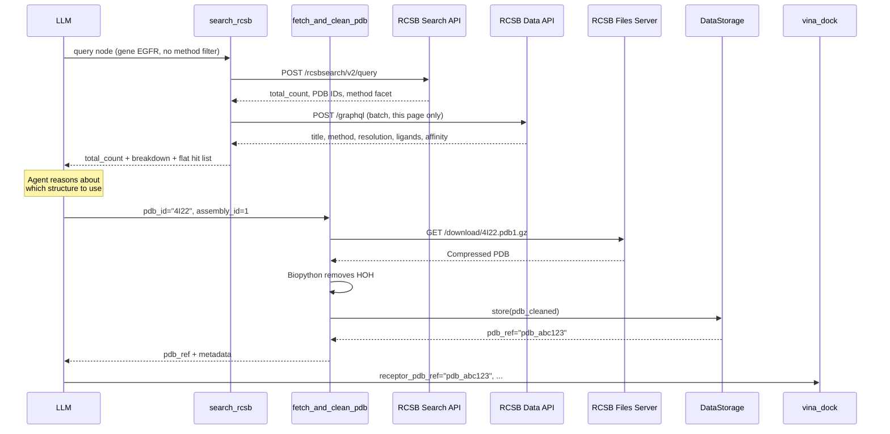

# RCSB PDB Tools Architecture

This document describes the architecture, design decisions, and workflows for the RCSB PDB tools that enable retrieval of experimental protein structures for molecular docking.

## Overview

The RCSB PDB tools provide a two-tool interface for the AI agent to retrieve structures from the Protein Data Bank (PDB). This design allows the agent to **reason about which structure to use** rather than receiving a black-box result.

### Tools

| Tool | Purpose | Data I/O |
|------|---------|----------|
| `search_rcsb` | Proxy the RCSB Search API — agent writes the query, tool enriches the hits | Text-only (returns JSON) |
| `fetch_and_clean_pdb` | Download biological assembly, remove waters, store for docking | Output-stores (returns `pdb_ref`) |

`search_rcsb` applies no filters of its own. The agent supplies an RCSB Search API query node verbatim, so the full attribute space (~1900 searchable fields) is reachable without a code change here.

## Architecture

```
┌─────────────────────────────────────────────────────────────────────────────┐
│                              User Request                                    │
│                    "Find a structure for EGFR docking"                       │
└─────────────────────────────────────────────────────────────────────────────┘
                                     │
                                     ▼
┌─────────────────────────────────────────────────────────────────────────────┐
│                             search_rcsb                                      │
│  ┌─────────────────────────────────────────────────────────────────────┐    │
│  │  1. Take the agent's query node verbatim (no filters added)         │    │
│  │  2. Bound request_options (rows cap, inject method facet)           │    │
│  │  3. POST to search.rcsb.org/rcsbsearch/v2/query                     │    │
│  │  4. Batch-enrich hits via data.rcsb.org/graphql                     │    │
│  │  5. Filter ligands (exclude ions/buffers) to set is_holo            │    │
│  │  6. Return total_count + method breakdown + flat ranked hit list    │    │
│  └─────────────────────────────────────────────────────────────────────┘    │
└─────────────────────────────────────────────────────────────────────────────┘
                                     │
                                     ▼
                    ┌────────────────────────────────┐
                    │       Agent Reasoning          │
                    │  - Reviews candidates          │
                    │  - Selects based on task       │
                    │  - May ask user for input      │
                    └────────────────────────────────┘
                                     │
                                     ▼
┌─────────────────────────────────────────────────────────────────────────────┐
│                         fetch_and_clean_pdb                                  │
│  ┌─────────────────────────────────────────────────────────────────────┐    │
│  │  1. Download biological assembly from RCSB files server             │    │
│  │  2. Parse with Biopython (Bio.PDB.PDBParser)                        │    │
│  │  3. Remove water molecules (HOH)                                    │    │
│  │  4. Store cleaned structure in DataStorageService                   │    │
│  │  5. Return pdb_ref for downstream tools                             │    │
│  └─────────────────────────────────────────────────────────────────────┘    │
└─────────────────────────────────────────────────────────────────────────────┘
                                     │
                                     ▼
                    ┌────────────────────────────────┐
                    │      Downstream Tools          │
                    │  - visualize_pdb               │
                    │  - vina_dock                   │
                    │  - structure_query             │
                    └────────────────────────────────┘
```

## Data Flow



## Implementation Details

### Dependencies

```
httpx                # Both RCSB APIs are reached over plain async HTTP
biopython>=1.83      # PDB parsing and manipulation
```

The `rcsb-api` client is deliberately **not** used. It calls `asyncio.run()` internally, which conflicts with FastAPI's event loop, and fetches a GraphQL schema from `data.rcsb.org` at import time, which can block application startup for minutes on a slow network. Both endpoints are plain JSON over POST, so `httpx.AsyncClient` needs no such workaround.

### Endpoints

| Endpoint | Purpose |
|----------|---------|
| `POST https://search.rcsb.org/rcsbsearch/v2/query` | The search itself. Returns identifiers, `total_count` and facets — no descriptive fields |
| `POST https://data.rcsb.org/graphql` | Per-entry facts for the current page of hits |
| `GET https://search.rcsb.org/rcsbsearch/v2/metadata/schema` | Attribute index for `find_attributes`, fetched lazily on first use |

### File Structure

```
backend/api/tools/
├── rcsb.py          # SearchRcsbTool, FetchAndCleanPdbTool
├── registry.py      # Tool registration
└── base.py          # BaseTool, DataIOCategory
```

### Key Classes

#### `SearchRcsbTool`

```python
class SearchRcsbTool(BaseTool):
    name = "search_rcsb"
    tool_type = ToolType.LOCAL
    data_io_category = DataIOCategory.TEXT_ONLY  # No storage needed

    async def execute(self, arguments):
        # The agent's query node goes through untouched. Only request_options
        # is rewritten, and only to bound the response size.
        payload = {
            "query": arguments["query"],
            "return_type": arguments.get("return_type", "entry"),
            "request_options": _apply_request_guards(arguments.get("request_options")),
        }
        result = await _run_search(payload)          # None on HTTP 204
        identifiers = _result_identifiers(result["result_set"])
        hits = await _enrich_entries(identifiers)    # batch GraphQL
        return ToolResult.text(self._format_hits(hits, ...))
```

Parameters:

| Parameter | Type | Notes |
|-----------|------|-------|
| `query` | object | An RCSB terminal or group node, verbatim. Required unless `find_attributes` is given |
| `return_type` | string | `entry` (default) is the only type enriched with per-entry facts |
| `request_options` | object | Passed through; `paginate`, `sort`, `facets`, `group_by`, `results_content_type`, `return_counts` all work |
| `find_attributes` | string | Keyword lookup over the search schema instead of a search. The discovery path for attributes outside the tool description's curated list |

#### `FetchAndCleanPdbTool`

```python
class FetchAndCleanPdbTool(BaseTool):
    name = "fetch_and_clean_pdb"
    tool_type = ToolType.LOCAL
    data_io_category = DataIOCategory.OUTPUT_STORES  # Stores cleaned PDB
    
    async def execute(self, arguments):
        # Download biological assembly
        url = f"https://files.rcsb.org/download/{pdb_id}.pdb{assembly_id}.gz"
        
        # Parse and clean with Biopython
        structure = parser.get_structure(pdb_id, pdb_content)
        io.save(output, NonWaterSelect())
        
        # Store and return reference
        ref = await self._storage.store("pdb", cleaned_content)
        return ToolResult.data_reference(ref, ...)
```

## Design Decisions

### 1. Two Separate Tools

**Rationale:** Separating search from fetch allows the AI agent to:
- Review multiple candidates before committing to a download
- Explain the options to the user
- Make informed decisions based on the specific task (apo vs holo, resolution needs)

**Alternative Considered:** Single "get_best_structure" tool that automatically picks. Rejected because it removes agent reasoning and user input from the decision.

### 2. No Filters of Our Own

The tool used to hard-code three filters, on the theory that they eliminated structures the agent should not have to evaluate:

- `exptl.method == "X-RAY DIFFRACTION"`
- `rcsb_entry_info.resolution_combined <= 3.0`
- `rcsb_entity_source_organism.taxonomy_lineage.name == organism`, defaulting to `Homo sapiens`

All three are gone, because the method filter in particular was not removing unsuitable structures — it was removing the only structures that exist. Measured against the live API:

| Gene | Entries in the PDB | Visible under the old filters | Method split |
|------|--------------------|-------------------------------|--------------|
| TRPV1 | 84 | 2 | EM: 80, X-ray: 4 |
| KCNQ1 | 33 | 4 | mostly EM |
| EGFR | 359 | 288 | mostly X-ray |

Ion channels, transporters, GPCR complexes and large molecular machines are solved by cryo-EM, and a 2.1 Å cryo-EM structure is not worse than a 2.1 Å crystal structure for the purpose of picking a docking receptor. The organism default was worse still: a bacterial or viral target returned nothing at all, with no indication that the empty result came from a filter the caller never asked for.

Two further consequences of filtering inside the tool are also fixed:

- **Truncation corrupted the ranking.** The old code took `pdb_ids[:50]` from a *relevance*-ordered result set and only then sorted by resolution, so "best resolution" meant the best of an arbitrary 50 out of 288. Sorting is now server-side via `request_options.sort`, over the whole match set.
- **Entries without a resolution were dropped twice.** NMR entries have no `resolution_combined` at all, so a `resolution <= 3.0` filter excludes them even with no method filter — and a `if resolution is None: continue` in the result loop excluded any that survived. `resolution` is now reported as `null`, which is a fact about the method rather than a missing value.

**What replaces the filters.** Deciding what counts as a usable structure is task-dependent, so it belongs to the agent, which now writes the filters itself in the query. Two things keep that from being a step backwards:

- Every result reports `total_count` for the full match set, so a narrow query is visibly narrow.
- When the agent supplies no facets of its own, a terms facet on `rcsb_entry_info.experimental_method` is injected. A search filtered to X-ray reports `EM: 80, X-ray: 4` in its own output, so the cost of the filter is on the page rather than invisible.

The tool's description tells the agent not to filter by method unless the task requires it, and cites the TRPV1 numbers as the reason.

### 3. Ligand Classification

**Problem:** PDB structures contain many non-polymer entities, but most are crystallization artifacts (ions, buffers, PEG) rather than drug-like ligands.

**Solution:** Maintain an explicit exclusion list:

```python
COMMON_NON_DRUG_LIGANDS = {
    # Ions
    'CA', 'MG', 'ZN', 'FE', 'MN', 'CU', 'NA', 'K', 'CL', ...
    # Buffers
    'SO4', 'PO4', 'GOL', 'EDO', 'PEG', 'ACT', 'DMS', 'MPD', ...
    # PEG variants
    'PGE', 'PG4', 'PE4', 'P6G', '1PE', '2PE', ...
}
```

This allows accurate apo/holo classification for docking candidate ranking.

### 4. Biological Assembly Download

**Problem:** The asymmetric unit in the PDB may not represent the functional oligomeric state of the protein.

**Solution:** Always download the biological assembly (e.g., `4I22.pdb1.gz`) rather than the asymmetric unit (`4I22.pdb`).

**Why it matters:** Docking to a monomer when the protein functions as a dimer could give incorrect binding site geometry and misleading results.

### 5. Water Removal

**Rationale:** Standard docking preparation removes bulk solvent. Waters:
- Interfere with docking scoring functions
- Are not relevant for most docking scenarios
- Can be added back for specialized analyses if needed

### 6. Async-Native, No Thread Pool

Both RCSB endpoints are now called directly with `httpx.AsyncClient`, so there is no `ThreadPoolExecutor` and no deferred imports.

This replaced a workaround for the `rcsb-api` client, which calls `asyncio.run()` internally — unusable from inside FastAPI's event loop — and which fetched a GraphQL schema at import. Every call had to be bounced through a four-worker thread pool, and the `rcsbapi` imports had to live in method bodies rather than at module scope so a slow network could not block startup. Dropping the client removed all of it, along with the dependency.

The one remaining lazily-fetched resource is the search schema backing `find_attributes`. It is fetched on first use rather than at startup, cached in the process, and on failure degrades to a message telling the agent to use the curated attribute list — failures are cached for five minutes so an outage does not add a timeout to every call.

### 7. Response Size Guards

`request_options` is passed through, with three exceptions, all of them about context budget rather than API semantics:

- `paginate.rows` is clamped to 25 (default 10). RCSB permits 10,000.
- `return_all_hits` is stripped. It ignores `paginate` entirely.
- `results_verbosity` is forced to `compact`, since descriptive fields come from the Data API instead — except for `group_by_return_type: "groups"`, where compact verbosity would discard the group members the agent asked for.

`paginate.start` is untouched, so the agent can page through the full result set.

Hits are rendered as one compact JSON object per line rather than an indented array. Indented JSON costs about a third more tokens for the same content, and the tool's response budget is raised to 5,000 tokens (from the 2,000 default) so that a full page never overflows. Overflow matters more here than for most tools: the budget preserves the head and tail of a response, which for a candidate list means silently dropping its middle — exactly the rows the agent is choosing between.

## Supported Workflows

### Workflow 1: Experimental Structure for Docking

```
User: "I want to dock a new inhibitor to EGFR"

1. search_rcsb(query={gene_name EGFR AND organism Homo sapiens},
              request_options={sort: [{sort_by: resolution_combined, asc}]})
   → total_count: 359, method breakdown, 10 hits with is_holo and ligands

2. Agent presents options, user selects or agent chooses based on task

3. fetch_and_clean_pdb(pdb_id="4I22")  # Best holo with Gefitinib
   → Returns pdb_ref="pdb_xxx"

4. aevom.download_pubchem_sdf(cid)  # New ligand (get CID from search_pubchem)
   → Returns SDF content for visualization

5. structure_query to find ligand center from holo structure
   → Get bounding box coordinates

6. vina_dock(receptor_pdb_ref="pdb_xxx", ligand_sdf_ref="sdf_yyy", ...)
   → Binding affinity in kcal/mol
```

### Workflow 2: Structure Comparison

```
User: "Show me both the apo and holo structures of EGFR"

1. search_rcsb(query={gene_name EGFR})
   → Pick one hit with is_holo: false (4HZR) and one with is_holo: true (5UG9)

2. fetch_and_clean_pdb(pdb_id="4HZR")  # Apo
   → pdb_ref_apo

3. fetch_and_clean_pdb(pdb_id="5UG9")  # Holo
   → pdb_ref_holo

4. visualize_pdb for both structures
```

### Workflow 3: Experimental vs Predicted

```
User: "What's the best structure for docking to PGK1?"

1. search_rcsb(query={gene_name PGK1}, request_options={sort by resolution asc})
   → Read total_count and the method breakdown, then judge the top hits.
     Do not pre-filter on resolution: a filter that matches nothing is
     indistinguishable from a gene that has no structures.

2a. If good candidates found (< 2.5 Å, any method):
    → fetch_and_clean_pdb → Use experimental

2b. If no/poor candidates:
    → fetch_protein_sequence → openfold3 → Use predicted
```

## Error Handling

| Error | Handling |
|-------|----------|
| No hits (HTTP 204) | Not an error. Returns text stating `total_count: 0` and suggesting the method or resolution clause as the likely culprit |
| Malformed query (HTTP 400) | RCSB's own message is relayed verbatim — it names the rejected attribute or operator, so the agent can correct and retry without a round trip through us |
| Unknown `return_type` | Rejected locally with the valid list, before a request is made |
| Data API unavailable | The search result still succeeded, so the PDB IDs are returned with a note that per-entry details are missing |
| Search schema unavailable | `find_attributes` degrades to a message pointing at the curated attribute list |
| PDB ID not found | Return error with suggestion to verify ID |
| Assembly not available | Fall back to asymmetric unit or try different assembly |
| Network timeout | Bounded at 30s per request; reported as a reachability error |

RCSB's 4xx bodies are relayed rather than rewritten because they are already precisely actionable:

```
search is not enabled on [ rcsb_entry_info.bogus_field ] attribute
Operator not supported: [ contains_words ] operator is not allowed for
  [ rcsb_entry_info.resolution_combined ] attribute.
```

## Telemetry

Both tools create spans under the parent `reasoning_iteration.N` span:

```
chat_request
├── reasoning_iteration.1
│   ├── llm.complete
│   └── tool.search_rcsb (5-10s)
├── reasoning_iteration.2
│   ├── llm.complete
│   └── tool.fetch_and_clean_pdb (1-2s)
```

Span attributes include:
- `tool.arg.query`, `tool.arg.return_type`, `tool.arg.request_options`, `tool.arg.pdb_id`
- `tool.raw.output` (full JSON, no truncation)
- `tool.result.success`

Because the query is now an argument rather than something the tool builds, `tool.arg.query` is the record of exactly what was searched for — useful when diagnosing why an agent got a narrow result.

## Future Enhancements

1. **Sequence similarity search**: The `sequence` service is already reachable through `query`; what is missing is prompt guidance on when to reach for it instead of a gene lookup
2. **Mutation mapping**: Identify structures with specific mutations
3. **Ligand similarity**: Find structures with ligands similar to the target compound
4. **Multi-chain complexes**: Better handling of protein-protein complexes
